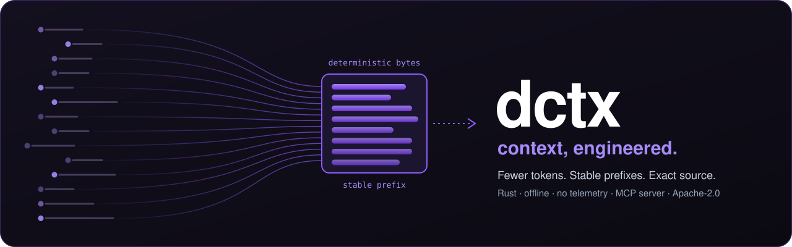

<!-- SPDX-License-Identifier: Apache-2.0 -->
<!-- SPDX-FileCopyrightText: 2026 Eris Margeta -->
<p align="center">
  
</p>

<p align="center">
  <strong>Turn a codebase into focused context for AI assistants.</strong><br>
  Pack a project, find symbols and read exact source locally. Stable output helps prompt caches reuse context.
</p>

<p align="center">
  
  <a href="https://github.com/Eris-Margeta/dctx/actions/workflows/ci.yml?query=branch%3Amain">
    
  </a>
  <a href="https://github.com/Eris-Margeta/dctx/blob/main/LICENSE">
    
  </a>
  
  <a href="https://github.com/sponsors/Eris-Margeta">
    
  </a>
  <a href="https://github.com/Eris-Margeta/dctx/blob/main/MAINTENANCE.md">
    
  </a>
  
</p>

<p align="center">
  <a href="#why-dctx">Why dctx</a> •
  <a href="#the-core-belief-prompt-processing-efficiency">Philosophy</a> •
  <a href="#installation">Installation</a> •
  <a href="#quick-start">Quick Start</a> •
  <a href="#map-mode-context-for-agents">Map mode</a> •
  <a href="#security--privacy">Security & Privacy</a> •
  <a href="docs/SPEC.md">Specification</a> •
  <a href="https://www.dctx.internet.technology/">Website</a>
</p>

---

## Installation

Download the archive for your OS and architecture from
[GitHub Releases](https://github.com/Eris-Margeta/dctx/releases/tag/v1.2.0), verify
its signature and signed `SHA256SUMS`, extract it, and put `dctx` (`dctx.exe` on
Windows) on `PATH`. Archives cover Linux x64/ARM64, macOS x64/ARM64 and Windows x64.
CLI releases produced by the supply-chain workflow include cosign bundles,
CycloneDX SBOMs, GitHub provenance and per-platform air-gap bundles. For an archive
and its `.sigstore.json` downloaded from the same release, use cosign 3.1.4:

```sh
TAG=v1.2.0 # select a release produced by the supply-chain workflow
ASSET=dctx-x86_64-unknown-linux-musl.tar.gz
cosign verify-blob --bundle "$ASSET.sigstore.json" \
  --certificate-identity "https://github.com/Eris-Margeta/dctx/.github/workflows/release.yml@refs/tags/$TAG" \
  --certificate-oidc-issuer https://token.actions.githubusercontent.com "$ASSET"
```

See [verification, provenance and offline installation](docs/VERIFYING.md) for
signed-checksum commands, `gh attestation verify`, trust preparation and build
reproducibility limits. Earlier releases do not retroactively gain this evidence.
CI covers Linux, macOS and Windows; see [the matrix and desktop exclusions](docs/TESTING.md).

**Coming soon:** `cargo install dctx-cli` and `npx dctx`. Registry packages are
not live yet; use the release archives now.

### From source

Requires Rust 1.91 or newer.

```sh
git clone https://github.com/Eris-Margeta/dctx
cd dctx
cargo build --locked --release -p dctx-cli
./target/release/dctx-cli --version
alias dctx="$PWD/target/release/dctx-cli"
```

Cargo builds `dctx-cli` (`dctx-cli.exe` on Windows); release archives supply
`dctx`. For a local source installation, use
`cargo install --locked --path crates/dctx-cli` and `alias dctx=dctx-cli`.
On Windows, invoke the executable directly or create a PowerShell alias.

## Quick Start

In 30 seconds, try a tiny project (POSIX shell; on Windows use Git Bash):

```sh
mkdir dctx-demo
cd dctx-demo
printf 'def hello(name):\n    return f"Hello, {name}!"\n' > hello.py
dctx map skeleton hello.py
```

Output from dctx 1.2.0:

```text
# dctx-demo skeleton
m:hello.py	module	L1-2	hello.py
s:hello.py#hello	fn	L1-2	def hello(name):
```

For your own project:

```sh
dctx pack .                # structured context on stdout
dctx pack . --clipboard    # copy it to the clipboard
dctx map find "SnapshotConfig"
dctx mcp                   # stdio tools for an MCP client
```

`pack` writes a file only with `--output`. Tree timestamps are off by default,
so a bare `touch` does not change its output; `--tree-stamps=on` includes them.
Run `dctx` without arguments for the interactive terminal menu.

---

## Which mode?

Use `dctx pack . --clipboard` for a one-off chat, plain grep plus file reads for a
small agent task, and `find` + `read --json` + `skeleton` for repeated work in big
files. Scope huge trees before indexing. MCP adds tool definitions to the agent's
starting context; smaller answers alone do not prove lower session cost.
See [Choosing how to use dctx](docs/MODALITIES.md) for commands, cache limits,
MCP overhead and CI guidance.

## Why dctx

<table>
<tr><td><b>Deterministic</b></td><td>Same source snapshot and request give identical bytes (every text verb checked over 5 runs on Linux; the cross-OS gate is still open). <code>dctx pack</code> tree lines carry no timestamps, so a <code>touch</code> changes nothing.</td></tr>
<tr><td><b>Prefix-stable</b></td><td>In a <code>dctx pack</code> page, an edit keeps every byte before the edited file as a shared prefix, which is what a provider's prompt cache reuses. Map and find answers were byte-identical after unrelated edits in 33/33 text and 33/33 JSON cases (<a href="docs/research/stability-20261105/REPORT.md">measured 6 Nov 2026</a>); layered prompt tiers are still a target (<a href="docs/SPEC.md">spec</a> PPE-3).</td></tr>
<tr><td><b>Private and offline</b></td><td>No telemetry, no model calls, no network. The release check counts socket calls under <code>strace -f</code> and fails on any. Secrets files are listed by name, never read.</td></tr>
<tr><td><b>Fast</b></td><td>Cold index of six historical benchmark corpora in 0.13-1.20 s, on one Linux x86_64 runner. This does not measure agent session cost.</td></tr>
<tr><td><b>Agent-ready</b></td><td><code>dctx mcp</code> is a stdio MCP server exposing the map verbs; answers are bounded and never split a record.</td></tr>
<tr><td><b>Broad</b></td><td>50 language families: 36 with symbols and lexical call edges, 8 with symbol outlines, 6 document formats with headed sections; run <code>dctx languages</code>.</td></tr>
<tr><td><b>Verified</b></td><td>TLA+ models of the cache lifecycle and the plugin system in <a href="docs/formal">docs/formal</a>, each with a mutation gate: every deliberately broken variant must be caught (plugins: 8 baselines, 59 mutants, 37 reachability witnesses). Plugin manifests and the plugin discovery index are verified with Ed25519 signatures.</td></tr>
<tr><td><b>Measured</b></td><td>Compare focused answers with grep plus file reads, then count startup context and all agent turns. <a href="#measured-in-the-open">Evidence and limits below.</a></td></tr>
<tr><td><b>Your choice of surface</b></td><td>CLI, Rust library facade, MCP server, and a <a href="apps/dctx-desktop">desktop app</a> (0.11 preview, free, Apache-2.0).</td></tr>
</table>

### At a glance

| | |
|---|---|
| Version | 1.2.0 |
| License | Apache-2.0 |
| Written in | Rust (2021 and 2024 editions): 36 crates plus the desktop app |
| CI coverage | Linux, macOS (ARM64 and x64), Windows x64; [matrix and exclusions](docs/TESTING.md) |
| Modes | `pack` (whole project or diff), `map` (agents), `mcp` (stdio server) |

---

## The core belief: prompt-processing efficiency

Every token you put in front of a model is paid for three times:

- **Prefill** — the model must process every input token before it answers. You pay per token, and you wait for it.
- **Cache misses** — providers serve repeated prompt prefixes from a cache for a fraction of the price and latency. One changed byte early in a prompt throws the rest of the cache away.
- **Attention** — answers get worse as irrelevant tokens pile up.

dctx exists to send **the fewest, most relevant bytes, in an order that stays the same between turns**, so prompts are smaller, caches hit, and the model reasons over exact source instead of guesses. That is the whole philosophy, and every feature has to earn its place against it. The [specification](docs/SPEC.md#2-the-core-belief-prompt-processing-efficiency) turns it into five testable constraints — bounded, deterministic, prefix-stable, non-redundant, honest — and eight metrics.

### One engine for every way software is built

| You work by… | dctx gives you |
|---|---|
| **Hand-coding** in an unfamiliar codebase | `dctx map` outlines, symbol search and exact source reads |
| **Copy-paste** into a chat assistant | `dctx pack` — the whole project or only what changed, in one structured block |
| **Tab completion** and IDE assistants | A library facade with millisecond reads for the editor's own context budget |
| **Agents** in a terminal | Bounded, copyable, deterministic answers: five verbs, one record per line |
| **Fully automated software factories** | A specification for signed organization policy and receipts; the policy lattice is planned |

### Zero RAG defects

Chunk retrieval over embeddings fails in predictable ways: it cuts functions in half, returns different chunks for the same question, serves stale code, leaks ignored files, and hides how much it cost. dctx does not use embeddings. It answers from a lexical graph of syntax-owned spans with explicit confidence, verifies source bytes before emitting them, and reports precision and freshness. The [spec](docs/SPEC.md#3-zero-rag-defects) names ten defect classes and their intended defenses; its [roadmap](docs/SPEC.md#31-roadmap-and-acceptance-gates) distinguishes the measured baseline from planned work.

---

## Where it comes from

dctx started in **2025 as `dircontxt`, written in pure C** ([`legacy-c/`](legacy-c/)), to solve the context problem while we were still moving to an AI workflow: one command that gave a model the whole project — structured, versioned, with diffs and a strict ignore system — instead of pasting forty files. It was rewritten in Rust in 2026 and grew a privacy-first core, a template system, a plugin host, a desktop app and map mode for agents. The goal has not changed: **context, engineered.**

---

## Map mode: context for agents

```zsh
# Run from this repository's root; map needs a file target.
dctx map map crates/dctx-cli/src/lib.rs --depth 2
dctx map find "SnapshotConfig"
# Use a stable ID returned by map/find for neighbors, explain and read.
dctx map neighbors 's:crates/dctx-cli/src/lib.rs#SnapshotConfig' --edge calls --dir in
dctx map explain 's:crates/dctx-cli/src/lib.rs#SnapshotConfig'
dctx map read 's:crates/dctx-cli/src/lib.rs#SnapshotConfig' --json
```

- **Source bytes**: `map read --json` includes source content; the current text renderer prints metadata only.
- **Bounded**: output uses an estimated token budget (up to 2,000; explain up to 1,000), not a model tokenizer guarantee, and never splits a record.
- **Deterministic**: the same tree and question give the same bytes, so prompt caches hit.
- **Precision and freshness**: use `--json` for the structured metadata. Structural declarations and conservative call edges do not imply exact semantic resolution.
- **Languages**: every supported language is in one of three tiers (full, outline, docs); see [Language tiers](#language-tiers) below or run `dctx languages`.
- **No Git, no network for map queries**: identity comes from dctx's own content digest; map does not need Git history or embeddings.
- **Skeleton and grep**: `dctx map skeleton <file>` prints the declaration signatures of one file, with no bodies, in source order. `dctx map grep <literal>` is an exhaustive literal search of indexed files, with hits grouped by enclosing symbol; `-i` makes it ASCII case-insensitive.
- **Hubs**: `dctx map hubs` lists the most-called symbols and the file and symbol counts per directory (`--limit` 1 to 60, default 20).
- **Path**: `dctx map path <FROM> <TO>` prints the shortest edge path (calls, imports, contains) of at most 8 hops, or `no path`.
- **Export**: `dctx map export --format json|mermaid` writes the whole graph as one deterministic document. The mermaid form is a flowchart of calls and imports. `--output PATH` writes a file.
- **Neighbors**: `--edge calls|imports` selects the edge kind, and `--depth` goes up to 4. Inbound call records carry their call-site lines, at most three per record: `\tL6,L7` in text and a `sites` array in JSON.
- **Find**: quote a multi-word concept as one argument; a name that spells the whole phrase ranks just under an exact name. For config keys with no symbol match, `find` falls back to literal hits, and a SCREAMING_CASE key (`HOME`, `DJANGO_SETTINGS_MODULE`) always lists the code that reads it after the best exact symbol.
- **Outline of a file**: `map map <file>` lists exported top-level declarations first, then the rest in source order, with impl blocks, constants and tests last; without `--budget` its page is 1,000 tokens so `--limit 40` is not cut early. Map and find text lines are `<id>\t<kind>\tL<start>-<end>`, since the id already names the path.
- **MCP**: `dctx mcp` runs a stdio MCP server that exposes the map verbs as tools, including skeleton, path and export.
- **Byte-stable answers**: the text header is `# <place> <verb>`, and JSON leaves out the snapshot digest, generation and age. `--meta` restores them.
- **Source limit**: `DCTX_MAX_SOURCE_BYTES` sets the total source bytes one scan may read (1 to 17179869184; default 1 GiB).


Details: [Map mode guide](docs/guides/MAP-MODE.md). The [benchmark evidence](docs/BENCHMARK-20261030.md) leads with grep plus file reads; older other-tool results are retained as historical evidence. Planned next — agent hooks, blast radius for a diff, delta answers and prefix-stable context tiers — is specified in [docs/SPEC.md](docs/SPEC.md#31-roadmap-and-acceptance-gates).

### Language tiers

`dctx languages` prints this table (`--json` for tools, `--markdown` for this block) from the one registry that also drives `dctx --version --verbose`; a test fails when the block below differs from it.

- **full**: symbols and call edges. Call edges are lexical, not type-resolved: they come from names, scopes and imports, never from a type checker, and ambiguous references are dropped.
- **outline**: symbols only; no call edges are promised. Shell function bodies can yield same-file call guesses, but v1 does not promise shell call edges.
- **docs**: headed sections.
- **Confidence**: `guess` marks the heuristic outline families, and every record from those files carries confidence `guess`; `structural` means a dedicated lexer or deterministic document rules.

<details><summary>Full language table</summary>

<!-- languages:begin -->
| Language | Tag | Files | Tier | Confidence |
|---|---|---|---|---|
| Rust | `rust` | `.rs` | full | structural |
| JavaScript | `javascript` | `.js`, `.mjs`, `.cjs`, `.jsx` | full | structural |
| TypeScript/TSX | `typescript` | `.ts`, `.mts`, `.cts`, `.tsx` | full | structural |
| Python | `python` | `.py`, `.pyi` | full | structural |
| Go | `go` | `.go` | full | structural |
| Java | `java` | `.java` | full | structural |
| C/C++ | `c` | `.c`, `.h`, `.cc`, `.cpp`, `.cxx`, `.hpp`, `.hh` | full | structural |
| C# | `csharp` | `.cs` | full | structural |
| Kotlin | `kotlin` | `.kt`, `.kts` | full | structural |
| Ruby | `ruby` | `.rb`, `.rake`, `.gemspec`, `Rakefile`, `Gemfile` | full | structural |
| PHP | `php` | `.php`, `.phtml`, `.inc` | full | structural |
| Swift | `swift` | `.swift` | full | structural |
| Vue/Svelte/Astro/HTML script blocks | `web` | `.vue`, `.svelte`, `.astro`, `.html`, `.htm` | full | structural |
| Scala | `scala` | `.scala`, `.sc` | full | guess |
| Dart | `dart` | `.dart` | full | guess |
| Zig | `zig` | `.zig` | full | guess |
| Solidity | `solidity` | `.sol` | full | guess |
| Gleam | `gleam` | `.gleam` | full | guess |
| Fortran | `fortran` | `.f90`, `.f95`, `.f03`, `.f08`, `.f`, `.for` | full | guess |
| Perl | `perl` | `.pl`, `.pm`, `.t`, `.psgi` | full | guess |
| Groovy | `groovy` | `.groovy`, `.gradle` | full | guess |
| PowerShell | `powershell` | `.ps1`, `.psm1`, `.psd1` | full | guess |
| Elixir | `elixir` | `.ex`, `.exs` | full | guess |
| Lua | `lua` | `.lua` | full | guess |
| OCaml | `ocaml` | `.ml`, `.mli` | full | guess |
| R | `r` | `.r` | full | guess |
| Julia | `julia` | `.jl` | full | guess |
| Haskell | `haskell` | `.hs` | full | guess |
| Erlang | `erlang` | `.erl`, `.hrl` | full | guess |
| Verilog/SystemVerilog | `verilog` | `.v`, `.vh`, `.sv`, `.svh` | full | guess |
| Terraform/HCL | `hcl` | `.tf`, `.tfvars`, `.hcl` | full | guess |
| SQL | `sql` | `.sql`, `*.sql.in` | full | guess |
| Clojure | `clojure` | `.clj`, `.cljs`, `.cljc`, `.edn` | full | guess |
| Common Lisp | `lisp` | `.lisp`, `.lsp`, `.cl` | full | guess |
| Scheme | `scheme` | `.scm`, `.ss` | full | guess |
| Emacs Lisp | `elisp` | `.el` | full | guess |
| JSON/JSONC/TOML/YAML | `config` | `.json`, `.jsonc`, `.toml`, `.yaml`, `.yml` | outline | structural |
| Shell | `shell` | `.sh`, `.bash`, `.zsh`, `.bats` | outline | guess |
| Makefile | `make` | `.mk`, `Makefile`, `GNUmakefile` | outline | guess |
| Dockerfile | `docker` | `Dockerfile`, `Containerfile` | outline | guess |
| Protobuf | `proto` | `.proto` | outline | guess |
| Pascal | `pascal` | `.pas`, `.pp`, `.dpr` | outline | guess |
| GraphQL | `graphql` | `.graphql`, `.gql` | outline | guess |
| Nix | `nix` | `.nix` | outline | guess |
| Markdown | `markdown` | `.md`, `.markdown` | docs | structural |
| Plain text | `text` | `.txt` | docs | structural |
| reStructuredText | `rst` | `.rst` | docs | structural |
| AsciiDoc | `asciidoc` | `.adoc`, `.asciidoc` | docs | structural |
| Org | `org` | `.org` | docs | structural |
| LaTeX | `tex` | `.tex` | docs | structural |
<!-- languages:end -->

</details>

---

## Organization control

The dctx Template System (DTS) defines output templates. The specification proposes extending it to selection, budgets, parsers, cache limits, plugins and privacy through a **seven-layer, signed policy lattice** — built-in → organization → tenant → machine → user → project → session — where each layer can only narrow the one above it. The lattice and `dctx policy explain` are planned, not current CLI commands. See [Part IV of the spec](docs/SPEC.md#part-iv--policy).

---

## Plugins

External effects are designed to run through out-of-process plugins with explicit capabilities and consent. The bundled Git plugin implements `.gitignore` protection and optional staging, but the current product host refuses native plugin launch, including the Git recipe; consent alone does not enable execution. See the [Plugins guide](docs/guides/PLUGINS.md).

```zsh
dctx plugin list
dctx plugin info dctx/git
```

---

## Security & Privacy

**The filesystem selection boundary excludes ignored file contents, including in debug mode.**

| Rule file | Behaviour |
|---|---|
| `.gitignore`, `.dctxignore`, global ignore | Excluded from normal selection; `--debug-ignored` can show ignored path metadata without reading content |

Selection happens before any byte is read, hashed, parsed or cached, and is checked again before output leaves the engine.

On top of the rule files there is a strict built-in deny with no override (no flag, no `!` negation, not even `DCTX_INDEX_IGNORED=1`):

- **Sensitive files** are listed by name but never read: `.env`, `.env.*`, `*.env`, `.envrc`, `*.pem`, `*.key`, `*.p12`, `*.pfx`, `*.jks`, `*.keystore`, SSH private keys (`id_rsa`, `id_dsa`, `id_ecdsa`, `id_ed25519`), `credentials`, `credentials.json` and other data extensions, `*.credentials.json`, `secrets.yaml`/`.yml`/`.json`/`.toml`, `.npmrc`, `.netrc`, `.pypirc`, `.pgpass`, `.htpasswd`, `.git-credentials`. The full list is in [ADR-014](docs/ADR-014-Privacy-Guarantees-and-Ignore-Semantics.md).
- **`.git`** at any depth is never listed or read by the map verbs, and never read by `pack`, even when a rule says `!.git/`.
- **Symlinks** are never followed: the final component is opened with `O_NOFOLLOW`, and a symlinked directory is listed by name only, never entered or read through.

dctx decides by file name only; a secret pasted into an ordinary source file is not detected. The shipped `pack`, `dctx map` and `dctx mcp` path is guarded by `crates/dctx/tests/map_sensitive_files.rs`, `crates/dctx/tests/git_and_symlink_privacy.rs`, `crates/dctx/tests/map_env_files.rs`, the unit tests in `crates/dctx/src/adapters/fs.rs`, `crates/dctx/src/domain/policy.rs` and `crates/dctx-pack/src/snapshot.rs`, and an end-to-end check that runs every command against a git-tracked canary fixture (`<repo>/scripts/checks/V1-1.zsh`).

```zsh
dctx pack . --debug-ignored  # see ignored paths in the tree without reading them
```

```gitignore
# .dctxignore
.env
.env.*
*.key
*.pem
.ssh/
secrets/
credentials/
```

The core pack/map workflows run locally, have **no telemetry**, **call no model** and **make no network calls**: the release check (`scripts/release-check.sh`) counts AF_INET/AF_INET6 connect/send calls under `strace -f` for every map verb, `pack`, `cache status` and `mcp`, and fails on any (it reports SKIP where strace cannot run). The current product CLI has no TLS network adapter for plugin discovery or downloads; network-capable distribution and plugin designs are documented separately. See the [Plugins guide](docs/guides/PLUGINS.md#what-is-not-yet-available) for current limits and [SECURITY.md](SECURITY.md) for private vulnerability reporting.

---

## Measured, in the open

<!-- bench:begin -->
<!-- Generated by scripts/render_readme.py. Baseline observations: docs/BENCHMARK-20261030.md; historical timing: docs/research/bench-3way-20261030/results/run7-53f8b6b/aggregate.json. -->

The baseline is **grep plus reading files**.

A controlled grep-plus-read benchmark that counts whole agent sessions (start-up context, every call, provider cache hits and accuracy) is being prepared; until it is published, dctx makes no whole-session savings claim.

Historical cold indexing of six benchmark corpora took dctx 0.13–1.20 s on one Linux x86_64 runner. This measures CLI wall time, not agent completion time or session cost.

[Choosing how to use dctx](docs/MODALITIES.md) covers scoping and MCP startup overhead. [Measurement evidence](docs/BENCHMARK-20261030.md) describes what was measured (tool-output bytes and estimated tokens); other-tool protocols are retained only as secondary historical notes.
<!-- bench:end -->

Older protocols and raw results are linked from the [benchmark evidence](docs/BENCHMARK-20261030.md) as secondary historical material. See also the [changelog](CHANGELOG.md).

---

## Out of scope for v1

- Any network or cloud feature.
- Watch or incremental mode beyond re-indexing.
- Shell call edges (shell is outline tier: symbols only).
- Embeddings or semantic search.
- LSP-grade type resolution: call edges are lexical.
- A stable plugin ABI or desktop API: neither is stable in v1.
- Cross-repository queries.

---

## Open source and maintenance

dctx is open source under the [Apache-2.0](LICENSE) license, which makes it free for any use, including commercial use. The core (`pack`) and every modality stay open, and no feature is held back behind a paid edition. Individuals and teams can support the project through [GitHub Sponsors](https://github.com/sponsors/Eris-Margeta). Companies that depend on dctx can fund its upkeep through a [maintenance agreement](MAINTENANCE.md), which covers security response times, long-term support and a written commitment for procurement (see [maintenance](https://www.dctx.internet.technology/maintenance/)). Paying never changes the license and never closes a feature. The "dctx" name and logo are trademarks of Eris Margeta; see [TRADEMARK.md](TRADEMARK.md) for what forks may call themselves.

All first-party code and documentation, including the desktop app and planned GPUI rebuild, are Apache-2.0, copyright Eris Margeta. Dependencies and vendored materials retain their own licenses and notices; see [THIRD_PARTY.md](THIRD_PARTY.md), [THIRD_PARTY_NPM.md](THIRD_PARTY_NPM.md) and [NOTICE](NOTICE).

The dependency policy retains the **Ed25519 signature verifier** (`ed25519-dalek`) for plugin/index verification. Signed organization policy bundles are planned; their presence in the specification does not mean the CLI can enroll or verify them today. See the [dependency policy](docs/SPEC.md#27-dependencies-and-build-profiles).

---

## CLI Reference

```
Usage: dctx [PATH] [OPTIONS]
       dctx pack [PATH] [--output PATH] [--clipboard] [--json] [--tree-stamps=on|off]
       dctx pack [PATH] --for <TEXT> [--budget TOKENS]
       dctx map <map|find|neighbors|explain|read> <TARGET> [--json]
       dctx cache status|gc|purge|config|auto
       dctx template build <PATH> | template list
       dctx plugin search|install|list|info|enable|disable|remove|update|verify|run
       dctx git <status|protect>

Snapshot options:
  -c, --clipboard       Copy to clipboard
  -d, --diff            Output the diff only (if available)
  -t, --tree            Tree only (skips file content)
  -r, --reset           Force V1 reset
  --tree-stamps=on|off  MOD: and SIZE: on tree lines (default off; on = the 1.0.0 text)

Filter options:
  --ext <list>          Only these extensions, e.g. rs,toml
  --binary              Include binary files (excluded by default)
  --empty | --non-empty Only empty / non-empty files
  --large <MB> | --small <MB>
  --hidden              Only hidden files and folders
  --debug-ignored       Show ignored paths without reading them
```

Run `dctx --help` for the complete reference and `dctx --version --verbose` for feature and precision limits.

---

## Use as a library

```toml
[dependencies]
dctx = { path = "crates/dctx" }
```

This path dependency assumes your Cargo project is at this repository's root; adjust it for another location. [`crates/dctx`](crates/dctx/) is the facade used by the CLI; the desktop uses [`crates/dctx-desktop-api`](crates/dctx-desktop-api/) on top of it. Python, Node and C bindings are planned on the same facade.

---

## Architecture

```
dctx/
├── crates/        # Rust workspace: pure core, mode engines, adapters, lexers, plugin host, facade, CLI
├── plugins/       # First-party plugins (dctx-plugin-git)
├── apps/          # dctx-desktop
├── legacy-c/      # The original C implementation (dircontxt)
├── docs/          # Specification, design records, contracts, formal models, guides
├── tools/         # Benchmarks, plugin tooling, test scripts
└── website/       # project website
```

Start with [docs/SPEC.md](docs/SPEC.md), then [docs/CRATE-MAP.md](docs/CRATE-MAP.md).

---

## License

Apache License 2.0. Copyright Eris Margeta. The desktop app is included under the same license. Paid maintenance agreements fund the project; see [MAINTENANCE.md](MAINTENANCE.md). See [LICENSE](LICENSE) and [NOTICE](NOTICE).

## Contributing

Contributions are welcome. Read [CONTRIBUTING.md](CONTRIBUTING.md) and the [specification](docs/SPEC.md) first.

---

<p align="center">
  <sub>Context, engineered. Built in Rust.</sub>
</p>
