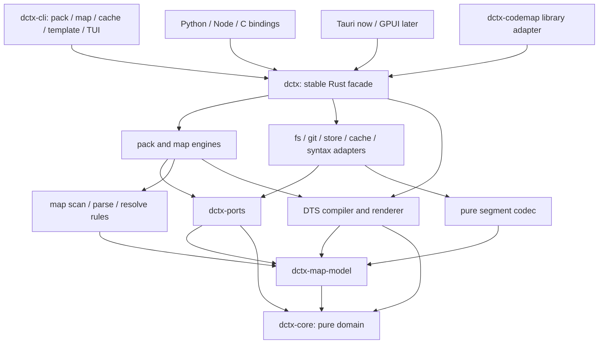

# dctx product architecture proposal

DX-ARCH · 2026-10-16 · Design proposal for the maintainer (decision 076); no implementation changes.

Recommendation: one Rust library contract for every product surface; a shared, content-addressed fact store with immutable binary segments, revision manifests and worktree overlays; safe buffered reads by default, with mmap and native parsers only as explicit optional capabilities. Treat measured context quality, privacy and resource bounds as release gates, rather than promising speed from a storage format alone.

This is a proposed successor to parts of the accepted ADRs and map specification, not authorization to change them. All performance numbers below are targets or planning estimates unless explicitly described as source evidence. No benchmark was run for this design packet.

## 1. What dctx is and its principles today

**Product.** dctx turns a source tree into context an agent can use: complete snapshots and diffs today, bounded structural exploration through map mode now, and future modes over the same facts. The useful unification is selection → facts → bounded context → rendering. Pack and map are complementary views; neither should inherit the other's command-line side effects.

**Principles and their sources.**

| Principle | Existing decision | Architectural consequence |
|---|---|---|
| One authoritative binary state | [ADR-001 §§2–4](../ADR-001-System-Architecture.md) makes the `.dctx` binary authoritative for history/diffs and treats text as output. | Rendered files must never become a second source of history. A revision manifest can be authoritative without putting every fact into one enormous file. Source code itself remains authoritative for current content. |
| Zero external production crates for the original core/CLI | [ADR-012 §§1–4](../ADR-012-Zero-Dependency-TUI.md) explicitly rejects external TUI crates; [README](../../README.md) promises zero dependencies and a single binary. | Distinguish **zero external crates**, **no separately installed runtime**, and **no subprocess requirements**. These are different contracts. A statically linked C library meets only some of them. |
| Organization templating language (DTS) | [ADR-003 §§1–5](../ADR-003-Templating-Engine.md): AOT compilation, four marker definitions, static variable resolution followed by runtime data injection, partials and layout. | Keep one compiler and renderer. Extend the language with typed selection and budget policy instead of building a second map configuration language. Current DTS controls formatting; indexing and budgets are proposed extensions. |
| Privacy before content access | [ADR-014, Rule System Definition and Guarantees 1–4](../ADR-014-Privacy-Guarantees-and-Ignore-Semantics.md). IGNORE and OMIT both prohibit reading file contents; OMIT preserves metadata. Debug visibility does not grant content access. | Authorization must precede hashing, parsing, snippets, cache lookup and rendering. Cached facts are also sensitive data. |
| Structural visibility without content noise | [ADR-008 §4](../ADR-008-Content-Omission-Pattern-System.md), [ADR-009 §4](../ADR-009-Binary-File-Detection-and-Content-Omission.md). | Preserve omission markers and binary classification; classify only authorized bytes. ADR-008's older read-then-omit sketch is superseded by ADR-014's no-read contract. |
| One explicit selection decision | [ADR-015b §§2–4](../ADR-015b-Ignore-Engine-Architecture.md): `Exclude`, `DebugVisible`, `OmitContent`, `Include`; typed errors and explainable rules. | Move the pure decision into the shared core; adapters load rules. Do not silently substitute defaults when a policy file cannot be read. |
| One product, multiple surfaces | [ADR-013 §§4, 7, 10](../ADR-013-Monorepo-Structure.md), [bindings plan](../../bindings/README.md). | CLI, Rust, Python, Node and desktop call the same library. Bindings are still planned; a directory README is not a shipped binding. |
| Map belongs to dctx | [SPEC-MAP-MODE §13a](../SPEC-MAP-MODE.md#13a-settled-2026-10-16-l1-under-laws-rule-39) overrides the earlier separate `dctx-map` proposal. | Keep `dctx map <verb>` and repository history. The earlier recommendation to discard pack/templates/desktop is obsolete. |

**Actual crate boundary, 2026-10-16.** [dctx-core](../../crates/dctx-core/src/lib.rs) has no production dependencies, but exports `walker`, `content_reader`, `registry`, `state`, `writer`, `config` and `git_safety`: it is not an IO-free domain core. Its header denies `unwrap` but explicitly permits `expect`; the new standard also disallows production `expect` and `panic!`. [dctx-cli](../../crates/dctx-cli/Cargo.toml) unconditionally links `dctx-map-query`, so the current CLI no longer has the original zero-external-crate closure. There is no CLI `lib.rs`; its entry header is [main.rs](../../crates/dctx-cli/src/main.rs). All six map library headers declare `forbid(unsafe_code)`, which covers their own code, not their dependencies or native libraries.

**Dependency census from every map manifest** ([model](../../crates/dctx-map-model/Cargo.toml), [scan](../../crates/dctx-map-scan/Cargo.toml), [store](../../crates/dctx-map-store/Cargo.toml), [parse](../../crates/dctx-map-parse/Cargo.toml), [resolve](../../crates/dctx-map-resolve/Cargo.toml), [query](../../crates/dctx-map-query/Cargo.toml)):

| Map crate | Direct external production packages | Count |
|---|---|---:|
| model | `serde`, `serde_json` | 2 |
| scan | `sha2`, `thiserror` | 2 |
| store | `rusqlite`, `thiserror`, `serde_json` | 3 |
| parse | `sha2`, `thiserror`, `tree-sitter`, `tree-sitter-rust`, `tree-sitter-md`, `tree-sitter-javascript`, `tree-sitter-typescript` | 7 |
| resolve | `thiserror` | 1 |
| query | `thiserror`, `serde`, `serde_json`, `rusqlite` | 4 |

That is **19 direct external dependency declarations, 10 distinct package names**, excluding internal path dependencies, dev dependencies and all transitives. `rusqlite` enables `bundled`: SQLite is compiled C. Tree-sitter's runtime and generated grammars are C, reached through Rust wrappers. Thus the new map violates literal zero external crates and an all-Rust memory-safety claim. It can still be delivered in one executable without separately installing SQLite or a language runtime. A single executable is not necessarily fully static on every OS.

The checked-in [Cargo.lock](../../Cargo.lock) still records `dctx-cli` with only `dctx-core` and has no map package entries. It cannot substantiate a resolved transitive count for the landed manifests. Report **10 direct names; resolved normal/build/target closure not yet established**, not the desktop workspace's unrelated total. The release gate must generate a consistent lockfile in the authorized CI environment and publish separate normal, build, dev, native and unsafe inventories for each feature profile. Tests/benches already use dependencies in the original core; “zero” has never meant the entire development toolchain.

**Other gaps, without inventing failures.** The map scanner is designed to preserve privacy; no ignored-file leak was established by this review. However, its [revision adapter](../../crates/dctx-map-query/src/adapters/revision.rs) runs broad `git status`, which can read tracked content outside dctx's selection. That needs a scoped replacement before claiming the no-read guarantee across all subprocesses. [Query database code](../../crates/dctx-map-query/src/adapters/database.rs) directly knows SQLite and FTS, bypassing a clean storage boundary. [CLI storage](../../crates/dctx-cli/src/map/storage.rs) uses one path-hashed SQLite database per worktree, unlike the spec's shared base/overlay intent. [Normal-mode config](../../crates/dctx-core/src/config.rs) defaults text output to `true`, while ADR-001 specifies `false`; it also puts `projects.db` in cache rather than the ADR's config directory. These are concrete reconciliation items, not reasons to discard the working product.

**Proposed promises.** The pure domain, engines and strict profile have zero external production crates and forbid unsafe. Optional adapters disclose their dependency/native/unsafe closure. The published general-purpose product remains one executable and one library implementation, with capability metadata stating exactly what is included. Rust safety does not prove freedom from logic bugs, out-of-memory termination, OS faults or unsafe foreign callers. “Complete memory safety” is a boundary goal for safe Rust-owned operations, not an honest blanket promise for Tauri, GPUI, mmap, C ABI or tree-sitter.

## 2. Product layout

**Target boundaries.** Dependency arrows below mean “imports the public API of”; runtime calls through an injected port do not create a reverse crate dependency. `dctx` is the stable facade crate, not another engine. The existing IO-heavy `dctx-core` remains compatible during extraction and becomes the pure core only at an announced breaking release.

```text
dctx/
├── crates/
│   ├── dctx-core/             # pure ids, selection decisions, budgets, errors, pack facts
│   ├── dctx-template/         # pure DTS compiler, typed plan IR and bounded renderer
│   ├── dctx-ports/            # Source, GitSnapshot, FactStore, Cache, Clock, Cancellation
│   ├── dctx-pack/             # snapshot/diff engine; no concrete IO
│   ├── dctx-map-model/        # pure map nodes, edges, provenance, queries and answers
│   ├── dctx-map-scan/         # selection/inventory orchestration through Source
│   ├── dctx-map-parse/        # safe Rust extractors; byte input → local facts
│   ├── dctx-map-resolve/      # contextual resolution and dependency invalidation
│   ├── dctx-map-query/        # five verbs and index planning through ports
│   ├── dctx-map-segment/      # pure binary codec, dictionaries, postings, validation
│   ├── dctx-adapter-fs/       # confined reads, rule loading, output writes
│   ├── dctx-adapter-git/      # explicit Git capability; never required by the engines
│   ├── dctx-adapter-store/    # filesystem-backed segments and manifest publication
│   ├── dctx-adapter-cache/    # quotas, leases, registry, lifecycle and history retention
│   ├── dctx-adapter-syntax/   # optional syn / tree-sitter implementations
│   ├── dctx-map-store/        # transitional SQLite adapter, eventually legacy-only
│   ├── dctx/                  # stable library facade and composition root
│   └── dctx-cli/              # one executable named dctx; CLI/TUI inputs and outputs
├── bindings/
│   ├── dctx-py/               # PyO3 + maturin → facade
│   ├── dctx-node/             # napi-rs → facade
│   └── dctx-ffi/              # versioned C ABI → facade; include/dctx.h
├── apps/
│   ├── dctx-desktop/          # existing TypeScript UI + src-tauri Rust backend → facade
│   └── dctx-desktop-gpui/     # future Rust UI → facade
├── docs/{design,adr,api}/
└── tools/                     # release/feature audit and corpus runners
```

These are ownership boundaries, not a requirement to create every empty crate at once. A future mode adds `dctx-<mode>` using existing facts/ports and a typed DTS capability; it never imports the CLI or desktop. The current desktop layout contains TypeScript settings/navigation/recent-projects modules and Rust `main.rs`, `config.rs`, `recent_projects.rs` under `src-tauri`; this proposal does not audit or redesign its UI. [Root workspace](../../Cargo.toml) already admits `crates/*`; future bindings and GPUI membership require their own authorized workspace change.



`dctx-ports` owns boundary traits whose data are core/model types; it imports no engine or adapter. It may split by bounded context if that simplifies feature isolation. Parser implementation types never escape the syntax adapter. JSON serialization moves out of pure `map-model` to the facade's optional wire adapter. Storage encoding stays with `map-segment`, not with domain structs. Engines can call `Source::read` but cannot call `std::fs`, read environment variables, spawn, log globally or choose cache locations. Domain functions take facts and return facts; `Path` as data is harmless, filesystem access is not. Public imports and source-level forbidden-IO checks enforce this distinction alongside the crate DAG.

**Library contract.** Expose owned, versioned request/result types, `ContextPlan`, `PackRequest`, `MapRequest`, `SnapshotHandle`, `Answer`, `Capabilities`, and typed `DctxError`. Build a session with explicit `Source`, storage policy, effective policy, limits and cancellation. `pack`, `map`, `find`, `neighbors`, `explain`, `read`, template compilation and cache administration are library operations. Streaming output is a bounded sink; source reads return checked spans. Snapshot handles pin a generation; borrowed results cannot outlive that handle. Callers never receive SQL connections, tree-sitter nodes or internal file paths as storage handles.

The API is synchronous and deterministic; applications schedule it on bounded worker pools. Async runtimes stay in frontends/adapters. A library session defaults to caller-owned or ephemeral storage, no home-directory discovery, no `.gitignore` edits, no global config, no unsolicited stdout. CLI policy explicitly enables global configuration and managed caching. This preserves ADR-001's library isolation rather than disguising CLI behavior as a library function.

**Features and distribution profiles.**

| Profile/capability | Contract |
|---|---|
| `default-features = false` | Pure types and caller-injected ports; no third-party production crates, IO or environment discovery. |
| `pack`, `map`, `templates`, `fs`, `segments`, `cache` | Strict distribution after the gates in §7: first-party safe Rust and std; no C or subprocess required. Map offers explicitly labelled structural extraction. |
| `syntax-rust` | Optional `syn` Rust syntax parsing; additional Rust dependencies, no type checking or macro expansion. |
| `syntax-tree-sitter` | Optional native parser bundle; precise syntactic coverage and error recovery, disclosed C/unsafe boundary. |
| `store-sqlite` | Legacy/comparison backend; opt-in after segment acceptance. |
| `git-process` / future `git-native` | Optional host Git or separately reviewed Rust Git adapter. Never silently enabled by `map`. |
| `mmap`, `wire-json`, `scip-import` | Explicit acceleration/interchange capabilities with separate dependency review; none changes core semantics. |

`dctx --version --verbose` and `Capabilities` identify the enabled profile, parser coverage, storage/protocol versions, native code and Git mechanism. Cargo features are additive, so “strict” cannot be made reliable by a feature name alone: CI audits its resolved closure and rejects accidental feature unification. Desktop and binding dependency graphs are audited separately. Do not ship a misleading zero-dependency badge for the enhanced build. The current tree-sitter/SQLite release remains supported until a candidate passes; there is no instant default switch hidden in this design.

**One binary and one source of truth.** Install `dctx`; `dctx pack`, `dctx map <verb>`, `dctx cache …`, `dctx template …` are subcommands. Preserve `dctx .` as a pack compatibility alias and no-argument TUI. Libraries link the same implementation into their host executable or extension module; they do not shell out to the installed CLI. “One binary” is a distribution/implementation promise, not a requirement that a Python wheel execute the CLI. The authoritative on-disk object is a validated binary manifest selecting immutable facts and history, with text/JSON as projections.

**DTS becomes the organization policy for every mode.** Retain v1 variables, partials, layout and marker syntax. A versioned v2 adds bounded declarative sections for `SELECT` (paths/languages/kinds and content permission), `INDEX` (facts and parser capability), `BUDGET` (bytes, estimated tokens, records, depth, parse time/memory), `VIEW` (pack/map/future-mode projection) and `RENDER` (partials/layout). The following is an illustrative language proposal, not accepted parser syntax:

```ini
[SELECT:engineering]
roots = ["src", "crates", "docs"]
languages = ["rust", "typescript", "markdown"]
deny = ["**/.env*", "**/credentials/**"]
[INDEX:engineering]
facts = ["symbols", "imports", "calls", "headings"]
parser = "structural"
[BUDGET:agent]
estimated_tokens = 500
hard_estimated_tokens = 2000
records = 40
depth = 2
[VIEW:map]
selection = "engineering"
budget = "agent"
layout = "AGENT_LINES"
[VIEW:pack]
selection = "engineering"
budget = "agent"
layout = "SNAPSHOT"
```

The compiler validates available fields, cycles, capabilities and resource bounds, then emits a versioned binary `ContextPlan` with a digest. Compiled defaults cost no runtime text parse; edited custom policies require `dctx template build`. Selection and extraction digests affect index validity; a rendering-only edit does not reparse source. Unknown opcodes/versions are errors. Bounded loops iterate authorized records only; no arbitrary evaluation, filesystem functions, subprocesses, network or dynamically loaded plugins.

Effective permission is `host grant ∩ organization ceiling ∩ session selection`; templates may narrow but cannot expand it. Within that ceiling, preserve the existing last-match ignore/omit semantics. Kernel callers supply `.legacyignore` and secret exclusions explicitly; desktop/CLI use their configured policies. `DebugVisible` grants metadata only. Budget limits intersect the host's limits and apply to the **final encoded answer**, including escaping, headers and continuation markers. Keep the spec's estimate `ceil(2 × UTF8_bytes / 7)` for compatibility, label it an estimate rather than a tokenizer guarantee, and offer an optional host-supplied tokenizer with a distinct capability. If even an envelope cannot fit, return a typed budget error. CLI text, JSON, Python and desktop all use the same bounded selection result.

## 3. The map mode re-imagined

**Optimize the context pipeline, not just lookup.** Preserve the five verbs, readable stable IDs, confidence labels, tier-0 summaries, bounded whole records, explicit moved/gone results and freshness diagnostics from [SPEC-MAP-MODE §§3–7](../SPEC-MAP-MODE.md). The architectural opportunity is to compute path-independent facts once, reuse them across authorized views, resolve them in the correct project context, and emit only what answers the question. Fast answers that omit the relevant edge or serve obsolete code increase total agent cost.

**Landed baseline.** SQLite/FTS5 provides transactions, recovery, indexing and a mature query implementation. Tree-sitter supplies Rust/JS/TS/Markdown syntax and malformed-file recovery. The query crate currently adds its own persisted JSON node/file payloads and SQL queries; [database.rs](../../crates/dctx-map-query/src/adapters/database.rs) uses WAL readers and an advisory writer lock, and orders an FTS query by floating-point `bm25`. [CLI storage](../../crates/dctx-cli/src/map/storage.rs) creates `<cache>/map/<hash-of-root>/index.sqlite`. [Inventory](../../crates/dctx-map-query/src/adapters/inventory.rs) reuses unchanged metadata stamps and hashes authorized changed files. This is a credible working baseline, but it duplicates indexes across roots, couples querying to SQLite, adds C, and cannot substantiate the proposed cross-worktree “parsed once” property. The earlier spec's commit-base/overlay layout is an intention, not what this path selection implements.

**Alternatives evaluated.** These axes compose: Git addressing is not itself a search engine, and changing storage does not fix parser precision.

| Option | Benefits | Costs and failure modes | Verdict |
|---|---|---|---|
| A. Keep per-worktree SQLite + FTS5 + tree-sitter | Lowest migration risk; strong recovery; broad syntax; immediate compatibility oracle. | C runtime/grammars; repeated parse/storage across worktrees; SQL leaks into engine; query startup and JSON decoding. | Keep as measured baseline and rollback, not final strict architecture. |
| B. Shared blob-fact cache + SQLite; manifests and overlays above it | Captures deduplication without building a storage engine; isolates whether reuse, not mmap, creates the actual win. | Still C and SQLite lifecycle complexity; raw facts must become path-independent; schema needs two-level resolution. | Build a limited comparison prototype. A useful fallback if segments miss their gates. |
| C. Shared facts + immutable binary segments, revision manifests, dirty overlays | Safe-Rust implementation possible; compact typed columns; bounded reads; cheap snapshot reuse; natural reachability GC; no SQL. | Must implement corruption checks, publication/recovery, compaction, postings and ranking correctly; cross-process reclamation needs coordination. | **Recommended target**, starting with buffered IO and a simple sorted dictionary. |
| D. Tantivy-style general search engine / embedded KV plus graph tables | Existing segment machinery and rich search, or simpler keyed persistence. | More third-party crates; dependency/unsafe audit required; search engine does not supply contextual graph invalidation or privacy; a KV still needs postings/ranking. | Benchmark reference, not a zero-dependency solution. Do not clone Lucene's full scope. |
| E. No persistent index: on-demand lexer + filesystem search | Tiny state and easiest cleanup; useful for small/ephemeral trees; no migration format. | Repeated reads/parses; difficult graph joins; higher cold latency and token/tool-call cost. | Keep as a small-tree/failure fallback, not the multi-worktree default. |

Choose C because it aligns reuse, memory ownership, privacy-aware views and cache lifecycle under one binary representation. Do **not** justify it with unmeasured “microsecond queries.” B establishes the value of content reuse independently; A remains releasable until C proves correctness and utility. FST/mmap are later accelerators with separate exit gates, not prerequisites for a coherent product.

**Content identity: challenge seed (a).** Git has already hashed committed blobs, but a blob OID identifies the Git blob bytes, not necessarily the checked-out bytes. CRLF conversion, `.gitattributes`, working-tree encodings, clean/smudge filters and LFS can make them differ. Dirty/untracked files, non-Git trees, submodules and a new parser version also invalidate “parsed once ever.” SHA-1 and SHA-256 repositories need algorithm-tagged IDs; equal text with different Git object algorithms does not automatically share an OID.

Use two key layers:

```text
ObjectKey = (identity_algorithm, digest, byte_length)
FactKey   = (ObjectKey, language, parser_revision, extraction_plan_digest, fact_schema)
ViewKey   = (root_identity, full_revision_or_tree_id, overlay_generation,
             selection_policy_digest, resolver_revision, environment_digest)
```

The reusable fact payload stores file-local symbols, byte spans, docs and raw references, **without absolute paths, root IDs, resolved target IDs or package-relative assumptions**. A view maps permitted paths to facts and attaches path-based public IDs. Resolution depends on module layout, imports, package metadata, enabled language configuration and the view's symbol table; it cannot be keyed by blob alone. Share parse facts across same-user roots in the same trust namespace, not resolved graphs. Tier-1 summaries additionally bind body/extractor/model provenance and are not generated by dctx itself.

For clean files with proven byte equivalence and trustworthy Git freshness evidence, use the algorithm-tagged Git blob OID without a dctx rehash. This is a fast path, not the correctness definition. If Git transformations are active or unknown, hash the authorized working-tree bytes; do not execute repository filters to obtain content. Hash dirty/untracked/non-Git input once while reading for parsing. An optional canonical SHA-256 alias can improve cross-algorithm sharing when bytes have already been read; do not read unchanged bytes merely to achieve that sharing. The strict profile needs a reviewed safe-Rust content-digest implementation with published SHA-256 vectors and differential tests; external `sha2` remains an explicit enhanced-profile option until that gate passes. This is integrity/deduplication, not authentication against a hostile same-user process. No vendored dependency is to be renamed first-party to claim “zero.”

On matching an untrusted external OID, validate the object's provenance/integrity before using it; scope weak/collision-suspect identities to their trusted repository and use the canonical digest when necessary. If facts were GC'd, schema/parser changed, or byte identity differs, reparse. The honest promise is **once per retained FactKey per trust namespace**, with concurrent duplicate work prevented by a bounded per-key reservation.

**Freshness and privacy are coupled.** Git's stat cache can avoid hashing most unchanged tracked files; it is neither free nor infallible. Racy timestamps, assume-unchanged/skip-worktree flags, filesystem changes and missed notifications require fallback. Never run unrestricted `git status` to discover freshness on behalf of an ignored-file policy. The Git port consumes path metadata/index evidence and probes only authorized content; bulk historical blob traversal is forbidden. Reading Git index/tree metadata is a narrow explicit capability even though `.git/` is excluded as source content. Reconstructing a packed allowed blob may require decoding delta bases containing excluded content: disable that object-read path under the strict no-read policy and use authorized working-tree bytes instead. Bare/history-only access therefore has a separately declared policy and may be unavailable.

Support three explicit freshness contracts: an immutable caller-provided source snapshot; a cheap metadata-validated live view (reported as such); and strict live validation, which reads/hashes authorized files needed for correctness and reports `stale/unknown` on a race. A metadata-only fast path cannot prove absence of an adversarial same-stamp edit. A `read` response validates the exact source bytes against its indexed digest before returning spans. A missing/changed policy file invalidates authorization before any cached fact can be served. Snapshot work is bounded: if full freshness cannot be established within the deadline, flag the scope or refuse it. Never call a metadata guess “verified current.”

**Segments: challenge seed (b).** A segment is immutable after publication. Append new **segments**, not bytes into a mapped live segment. Each segment has a magic number, format version, bounded section directory, lengths, checksums and explicit little-endian encoding. Sections hold string/name dictionaries, file-local facts, delta-coded postings and forward/reverse adjacency; no native struct layout, unaligned casts or serialized pointer graphs. The safe decoder validates lengths, offsets, arithmetic, UTF-8 and cardinality before exposing borrowed slices. Corruption returns a typed error and schedules rebuild, never unchecked access or a panic.

Start with a sorted dictionary plus sparse prefix offsets and compact postings; exact lookup is logarithmic and the implementation is inspectable. Introduce a minimal name FST only if its measured size/latency advantage justifies the extra codec/builder and fuzz surface. Keep identifier/path/doc field postings and document lengths for deterministic fixed-point ranking; integer scoring and tie-breaking by full stable ID remove cross-backend floating-point ambiguity. Preserve query quality against the existing FTS oracle instead of requiring identical floating scores. A query merges the pinned base and overlay, masks deleted/replaced files, and ranks a bounded candidate set. Dependency invalidation follows changed imports, exports and unresolved-name reverse indexes; it cannot stop at the changed file's own edges. Large fan-out changes use an explicit pending/stale generation until resolution is complete.

Per-revision manifests reference the same fact segments. Worktree overlays contain dirty replacements, additions and deletion tombstones; they distinguish HEAD, index/staged state and working-tree state, including unmerged files. Public node IDs remain path/name based; internal dense IDs are manifest-local. Prefix/alias collisions must expand to disambiguation rather than returning an arbitrary match. Move inference reports ambiguity when multiple bodies match. Cross-file graph links, manifest/package changes and compiler-option changes invalidate the contextual resolution layer even when every source blob is cached.

Publication is a transaction over a manifest generation:

1. Acquire a single-writer lock for that root/view; reserve disk budget and pin all inputs.
2. Write new segments to unique temporary names, validate, flush and sync as supported; publish immutable filenames without replacing live segment contents.
3. Write and sync a manifest naming only complete segments, then atomically replace the small current-generation pointer; sync its containing directory where supported.
4. Release the writer; retain the old generation until readers release their pins. Recovery selects the newest valid committed manifest and discards incomplete staging later.

Atomic rename is a visibility primitive, not mutual exclusion or durability by itself. Use an OS-released writer lock; lockfiles are not cleared merely because a PID looks old. Windows replacement/open-file semantics need a tested platform implementation; unsupported filesystems return an explicit durability capability rather than silently promising POSIX behavior. Readers take a short generation/lease acquisition handshake with GC, then query immutable data without per-query data locks. If the referenced generation disappears during acquisition, retry before exposing a handle. Existing readers continue without waiting for a writer. Do not advertise literally “any readers without locks”: handles, pins and reclamation still need coordination.

**mmap is optional.** `std` has no safe portable mmap API. Mapping through FFI or a crate introduces an unsafe dependency and OS lifetime/truncation hazards; the Rust standards forbid first-party unsafe. Use immutable `Arc<[u8]>` buffers or bounded positioned reads in the strict build, borrowing fields from validated buffers. This avoids record-copy/deserialization churn but is not zero-copy disk IO. An optional reviewed mmap adapter must enforce immutable file lifetimes, pin against GC/truncation, document malicious same-user mutation limits, and satisfy the policy exception for its dependency. If these cannot be guaranteed, use buffered reads. FST and mmap do not by themselves make end-to-end fresh queries microsecond operations.

**Parsing: challenge seed (c).** “Pure Rust” is not synonymous with “zero dependencies,” and “syntactic” is not “semantically exact.” Preserve explicit capability/precision labels per answer. Approximate extractors must emit unresolved/unknown rather than confidently wrong edges.

| Parser choice | Safety/dependency boundary | Coverage/precision contract | Unmeasured planning envelope, incremental release size and parsing throughput |
|---|---|---|---|
| First-party safe structural Rust/JS/TS/Markdown extractors | 0 external production crates; 0 first-party unsafe blocks. | Declarations, imports, headings and conservative calls. Rust macros, TS generics/JSX, regex/template literals and malformed files need explicit coverage; no exact semantic calls. | +0.5–2 MiB; 40–150 MiB/s per worker on the defined corpus; target ≥98% declaration precision, ≥85% recall. |
| `syn` for Rust | External Rust dependency closure; transitive unsafe must be audited rather than inferred from language. | Full supported Rust syntax and spans; no name/type resolution or expansion; often rejects incomplete files without a fallback. | +1–4 MiB; 10–60 MiB/s; target ≥99% declaration precision/recall on supported valid Rust fixtures. |
| Small grammar DSL compiled to safe Rust | Runtime can use only std; build tooling and generated code have their own audit. | A useful evolution for bounded extractors; recreating full JS/TS grammars is a language-tooling project, not a small shortcut. | +1–6 MiB; 10–100 MiB/s; no credible precision guarantee until held-out corpus evidence. |
| Existing tree-sitter + four grammar packages | Five external parser packages, runtime plus generated C, Rust FFI/unsafe dependency boundary. | Strong error-tolerant syntax; macro/dynamic dispatch/type resolution still not exact. | Parser bundle +3–12 MiB; 5–50 MiB/s; target ≥99% declaration precision, ≥95% recall on held-out mixed valid/incomplete fixtures. |

The size/rate ranges are hypotheses for capacity planning, **not measurements or comparative claims about these packages**. Report compiler, target, LTO/strip options, grammar versions and corpus for actual results. Measure `precision = correct_emitted / emitted`, `recall = correct_emitted / expected`, separately for declarations, imports, calls and doc spans; a declaration target never stands in for call-edge correctness. For emitted `exact` edges require no known false positives in the adjudicated corpus and downgrade anything unresolved; test this separately from recall. An abstention is safer than inventing an edge but still counts against recall. Include malformed, minified, Unicode, macro-heavy, mixed JSX/TS and generated-file fixtures, plus adversarial depth/size limits.

Recommendation: structural extractors are the strict default **only after** these coverage gates; optional `syn` improves valid Rust coverage, optional tree-sitter preserves the current rich mode for users needing broad syntax. Retain tree-sitter in the supported release until replacement evidence exists. Defer a general grammar DSL: prototype it for one bounded language first. SCIP import can upgrade evidence later, while preserving provenance. This intentionally revisits §13a's tree-sitter settlement for the maintainer to decide; it does not pretend L1 never approved it.

**Acceptance targets and accounting.** Use a pinned representative 5,000 included-file corpus, 50 MiB UTF-8 total, 100,000 symbols, 300,000 edges, mixed Rust/JS/TS/Markdown, local SSD, 8 physical performance-class cores, 16 GiB RAM, fixed compiler/profile, at most 4 parser workers. Publish hardware and file distribution with each run. A target scales with bytes, facts and edges, not just file count. External grammar compilation/download time is build time, not indexing time.

| Metric | Target for recommended segments profile | Measurement boundary |
|---|---:|---|
| Cold full index | ≤5 s wall; ≤3 s stretch | No dctx facts, cold source-cache run reported separately from warm OS pages; scan, authorized reads, parse, resolve, postings, durable publication included. |
| Same-commit new worktree view | ≤250 ms | Facts already retained; construct permitted path view; disclose metadata/Git cost and any unresolved refresh. |
| Warm exact name/ID lookup | p50 ≤100 µs, p95 ≤500 µs | In-process, pinned validated generation, resident pages; no scan, no process startup. |
| Warm ranked `find` | p95 ≤2 ms | Same pinned generation; rank and render ≤40 candidates under 2,000 estimated tokens. |
| Live query in resident library | p95 ≤30 ms | Metadata freshness contract over the corpus, bounded overlay processing; strict hash validation measured separately. |
| Fresh-process CLI query | p95 ≤60 ms | Startup, opening snapshot, metadata validation and rendering included; no promise for strict full hashing. |
| Reindex one 10 KiB file | p95 ≤25 ms; ≤50 ms gate | Includes affected resolution and publication when fan-out ≤100; separately report high-fan-out manifests/exports. |
| Indexing peak RSS | ≤256 MiB | Four workers, bounded queues and segment builders; no retained whole-repo AST. |
| Warm library query RSS | ≤64 MiB; map working set ≤32 MiB | Increment over empty host separately; mapped virtual size is not resident usage. |
| Persistent map disk | ≤8 MiB per 1,000 files; ≤40 MiB for this corpus | Retained parse facts + one live resolved view + names/postings + manifests, excluding source bytes. Temporary compaction ≤2× live disk, within global reservations. |
| Additional clean worktree | ≤1 MiB per 1,000 paths | Shared facts, its view metadata and bounded resolution delta; identical environment/views should share resolved segments too. |

A disk model makes the target falsifiable: `D ≈ F·b_file + S·b_symbol + E·b_edge + D_names + D_postings + D_manifests`. For 1,000 representative files, 20k symbols and 60k edges, budgets of 128 B/file, 64 B/symbol and 12 B/edge use about 2.1 MiB, leaving about 5.9 MiB for strings, summaries, postings, views and overhead. Long docs, giant signatures or dense graphs must truncate with provenance or report a limit; they cannot silently violate the cap. Peak memory is bounded by `worker_count × max_file_and_parser_memory + queued_bytes + segment_builder_bytes + query_cache_bytes`.

The release benchmark compares A/B/C on the same corpus and quality labels, records median/p95 over at least 30 queries/runs where appropriate, and measures amortized parse count, disk amplification and view reuse. Prefer segments only if they meet correctness gates and materially improve at least two of warm query latency, cross-worktree disk and refresh cost without a material quality loss. Keep performance thresholds out of load-sensitive unit tests. Product success additionally requires the [spec §11](../SPEC-MAP-MODE.md) advisory/seeded experiment: ≥50% fewer exploration tokens, ≥25% fewer total input tokens, ≥50% fewer calls before first edit, with acceptance rate not degraded, using at least 30 accepted packets per main route. Storage microbenchmarks cannot substitute for that evidence.

## 4. The cache lifecycle

**Managed state has an owner, a quota and an expiry.** The current large normal-mode files include both binary snapshots in the user cache and text/diff outputs under the selected project's `.dctx/`; choosing the home directory as a project can put those outputs under the user folder. Source inspection establishes those paths/defaults, not the sizes or provenance of files on the maintainer's machine. This packet neither inventories the home directory nor deletes anything.

| Data | Proposed default location | Lifetime and recovery |
|---|---|---|
| Linux cache | `${XDG_CACHE_HOME:-~/.cache}/dctx/v2/` | Managed, reconstructible state. |
| macOS cache | `~/Library/Caches/dctx/v2/` (explicit absolute override wins) | Migrate recognized old `~/.cache/dctx` artifacts by the procedure below. |
| Windows cache | `%LOCALAPPDATA%\dctx\Cache\v2\` | Same policy and quotas; platform-specific publication implementation. |
| Configuration and policy sources | Linux XDG config, macOS Application Support, Windows roaming config | User-owned; never deleted by cache GC/purge. Preserve existing config locations during migration. |
| `facts/`, `segments/`, `views/`, `roots/` | Under the managed cache root, partitioned by trust namespace and schema | Binary manifests/register of explicitly opened roots; no scan of every home-directory repository. |
| `pack/`, `templates/`, `tmp/`, `leases/` | Under the same managed root | Pack history is evictable only under its explicit retention policy; compiled templates rebuild from retained sources. |
| Explicit exports | User-selected path, or legacy `.dctx/` | User documents, not automatically disposable merely because dctx once wrote them. |

CLI configuration resolves the cache root once; libraries require an explicit path or ephemeral policy. `DCTX_MAP_CACHE` remains a deprecated compatibility override with a reported effective path. Never let a relative override, symlink escape, or path-prefix mistake place cache objects into a source root. Managed directories are private to the user (0700/0600 where applicable, restricted ACLs on Windows); caches contain proprietary code facts even without full source. No shared cross-user cache. Portable/external cache paths must be explicitly selected and support the required filesystem semantics.

Portable std path canonicalization alone cannot guarantee confinement against a hostile concurrent directory/symlink replacement. The strict filesystem profile assumes a trusted same-user filesystem namespace and still checks identities/races; an adversarial namespace requires caller-supplied immutable snapshots/opened capabilities or a separately reviewed platform adapter. Refuse a requested confinement guarantee that the selected adapter cannot provide. Safe Rust memory access is not a proof of race-free path authorization.

**Defaults, measured in binary bytes.** Global hard cap **2 GiB**, soft watermark **1.5 GiB**, target after eviction **1.2 GiB**. Count committed objects, dirty overlays, pack history, WAL/legacy caches during coexistence, temporary writes, obsolete pinned generations and pending deletion—not only live segments. Shared facts count once globally; root usage reports exclusive plus shared bytes so totals are explainable. New map view/overlay allowance is 256 MiB per root unless raised; pack history allowance is 256 MiB per root; these are ceilings within the global cap, not extra allocations.

Keep at most three recent committed view manifests per root and idle overlays for seven days. Expire unpinned root registration after 30 days without use, with last-known roots visible in status until their records are compacted. A missing root is not immediately “deleted”: disconnected disks and temporary permission failures retain existing data for seven days, then become ordinary expiry candidates; explicit pins opt out of expiry but not physical capacity. Normal pack retention keeps the latest snapshot plus one predecessor by default, bounded by the root quota. An object larger than its quota produces `CacheLimit` or an explicit ephemeral session; never silently expand the quota. Users wanting durable archival history export/pin it under an explicit storage budget. Cache eviction can reset the next diff baseline; the next answer states `history_reset`, never pretends an old version still exists.

**LRU and reachability have different jobs.** LRU chooses which unpinned root/view/history manifests to retire under time/space pressure, with last-use times coalesced to at most one write per root per five minutes. Reachability decides which facts/segments can then be reclaimed. Do not evict a fact still referenced by a retained live manifest to satisfy LRU; retire its owner first or return a capacity error. No filesystem atime dependency.

Define `R` as retained registered-root views, overlays and explicitly pinned history, and `L` as active reader/writer leases. Mark the transitive referenced set `Live = closure(R ∪ L)`. Facts for a blob ID not reachable from any retained registered-root manifest or lease are garbage after the grace period. Here “reachable” means reachable from dctx's retained snapshots of allowed paths, **not every Git object in every historical branch**. Traversing all Git history would read excluded data, run without a useful bound and prevent effective GC. A user can pin an additional branch/revision view explicitly; changing branches reuses facts still retained, otherwise reparses them.

Segments mix facts, so dropping a reference does not immediately recover their bytes. Rewrite segments when dead bytes exceed 25% or the soft cap is reached, publish a new manifest, and reclaim old segments after pins drain. Reserve staging space before compaction. If `used + reserved + estimated_new > hard_cap`, first reclaim safe garbage; if no headroom remains, refuse persistent indexing with a bounded explanation and offer ephemeral mode. Pinned readers can prevent reclamation; their bytes remain in status and writes stop rather than violating the hard cap. GC never truncates an existing segment, especially one that might be mmap'd.

**Cleanup on start, without a daemon or reboot service.** On normal CLI/session startup, check a small lifecycle ledger. If cleanup is due (once per day, soft-cap pressure, incompatible generation, abandoned staging), acquire a nonblocking maintenance lock and perform at most 25 ms / 128 objects of work, then persist a cursor for the next invocation. This is a target and work bound, not a guarantee of filesystem latency. Extend idle work only within an explicit operation budget. Ordinary query readers can proceed on valid snapshots while maintenance waits. Explicit `gc` completes the remaining work with progress/cancellation and a caller-selected budget. No cron, watcher, launchd helper or permanent background process is needed.

At the first dctx invocation after a restart, OS locks held by the previous process are gone. Reconcile leases using held OS locks plus session identity/boot identity when available; **PID age alone is not proof** because PIDs are reused and machines sleep. Incomplete staged objects without a live lease and older than 24 hours are reclaimable; boot change can accelerate only objects proven incomplete and unowned. Validate current/previous manifests before deleting recovery inputs. A crash after segment publication but before manifest commit leaves unreachable objects; a crash after pointer commit leaves a valid generation. Cleanup happens on the next invocation, not immediately at boot if dctx never runs. OS temp directories may also be cleaned by the OS, but dctx cannot rely on that for its persistent cap.

**Public commands, available through the same facade.**

```text
dctx cache status [--json] [--root PATH]
dctx cache gc [--dry-run] [--root PATH] [--max-bytes N]
dctx cache purge --root PATH [--dry-run] [--yes]
dctx cache purge --all [--dry-run] [--yes]
```

`status` reports cap, live/shared/reclaimable/pinned/pending bytes, roots, history retention, active leases, incomplete migrations and the last/next GC result. `gc` applies the retention contract and returns reclaimed/pending counts and reasons. `purge` drops selected managed references (and shared facts only when no other reference needs them); active handles remain valid and their storage is marked pending deletion. A CLI purge requires an explicit root/all selection and interactive confirmation unless `--yes`; the API takes an explicit destructive-operation request. Purge does not imply deleting config, template sources, source files or user exports. Sensitive data on SSDs cannot be guaranteed securely erased; purge promises removal from managed live storage and eventual unlink, not forensic erasure.

**Normal mode and existing outputs.** New explicit `dctx pack` defaults to stdout/clipboard or an explicit `--output`, with bounded managed history; it stops creating unsolicited text files. For one compatibility minor release, `dctx .` retains its documented legacy behavior but reports the output location/size and how to opt into managed-output retention. The next announced breaking release aligns both aliases with ADR-001's text-output-off default. All successful writes report bytes and retention class. Clipboard-only mode never leaves a temporary text copy; no fallback to a home-directory dump on an error. Stream large explicit exports through a bounded sink rather than building duplicate full strings in memory.

For managed temporary previews, keep at most two generations, 64 MiB per root, and seven days; include them in the 2 GiB cap. Explicit durable exports have no automatic TTL. An optional `dctx cache gc --legacy --dry-run` reads only the existing registry/configured output locations and identifies recognizable old `.dctx` binaries and generated text/diff headers; it never recursively hunts for large files in the user's home. The apply form requires explicit user selection/consent, verifies unchanged identity and ownership again, and reports reclaimed bytes. A filename extension alone is not ownership evidence. Modified exports, arbitrary absolute output paths, unknown binary versions and unregistered files are left alone. Existing text/diff files become managed only after opt-in adoption into an ownership manifest, so an upgrade cannot silently destroy someone's saved context.

Migrate cache state by validating one known source manifest/artifact at a time, reserving space for the copy, writing v2 state, verifying it, then retiring the old owned copy only when no legacy reader holds it. On insufficient space, keep the old version and report the needed bytes; do not double the user's cache unnoticed. Compiled templates are disposable, template **sources** are not. Map schema mismatch rebuilds only authorized current content; pack binary history is decoded by an explicit versioned importer and preserved or reported unsupported, never discarded as though it were just a map index.

**Privacy changes invalidate old views immediately.** If a path becomes ignored/omitted, prevent queries, excerpts, summaries and renderers from serving its old facts before the next GC. Mark affected manifests unavailable and rebuild their permitted projection. Physical bytes can remain temporarily because another allowed root or reader pins them; status distinguishes authorization revocation from disk reclamation. Use separate trust namespaces for organizations requiring independent retention/purge. This prevents cross-root deduplication from becoming a cross-policy data leak.

**Numbered properties for the implementation/formal model.**

1. **P1 — no unauthorized content:** if selection is not `Include`, no content read/hash/parse/cache-content response occurs for that path; debug may read metadata only.
2. **P2 — immutable visibility:** a visible generation references only complete validated objects; each reader observes one generation.
3. **P3 — safe reclamation:** no object reachable from retained manifests or active leases is unlinked or truncated.
4. **P4 — bounded storage:** committed + staged + reserved + pending bytes never exceed the configured admission cap; pre-existing oversized legacy state admits no growth until reduced.
5. **P5 — bounded truthful answers:** the final wire output respects the applicable budget and identifies stale/unknown scopes and parser precision.
6. **P6 — deterministic views:** identical source snapshot, effective policy, parser/resolver versions and query produce identical result ordering/rendering; clock-derived age is injected/frozen.
7. **P7 — correct sharing:** a FactKey identifies one byte/extraction contract; path/context-dependent edges are resolved per compatible view.
8. **P8 — progress:** with finite inputs, available capacity, fair maintenance and eventually released leases, publication/GC either completes or returns a typed refusal; a crashed writer cannot block forever.

Model writer/publication/read-lease/GC interleavings before storage replacement, with crash points and non-vacuous mutation checks. Property tests cover P1–P8, with positive controls for every refusal path. This follows the project code guidelines and Rust standards; it is a future acceptance requirement, not a claim that the current implementation has already been formally verified.

## 5. Integration with a host application

**Recommend direct library linking through the existing kernel-owned `CodeMap` port.** The kernel's domain must not depend on dctx storage or frontend types. Its adapter depends on the stable `dctx` facade, maps typed requests/results to the kernel's bounded records, and injects root permissions, source capabilities, cache path, clock and budgets. This gives Eris one running kernel binary with no `dctx` subprocess, shared warm snapshots and no JSON encode/decode on the hot path. The standalone CLI remains useful to people and external workers.

**R-60 is real and should be evolved, not described as missing.** Its packet specifies a process-first `dctx-codemap`, a fake, five verbs, re-declared JSON records, timeouts and bounded pipes. The inspected domain exposes those verbs and typed errors; DctxCli invokes `dctx map … --json --place …` without a shell, handles missing binary, timeout, output flood, busy and malformed envelopes, then kills/reaps on failure. That is a legitimate isolation adapter. It also repeats startup, process management and serialization and requires an independently compatible executable.

| Property | Current process adapter | Proposed linked adapter |
|---|---|---|
| Distribution | Kernel plus installed/configured dctx executable | One kernel executable linking the chosen library profile |
| Warm reuse | Disk/OS cache; process exits per query | Retained generation handles and bounded shared in-memory dictionaries |
| Dependency/version coupling | Wire envelope compatibility; separate releases | Facade semver + pinned dependency/profile; rebuild kernel to upgrade |
| Cancellation/isolation | Child can be terminated on deadline; address-space isolation | Cooperative cancellation and bounded input/work; no safe forced thread kill |
| Failure surface | Process, pipe, JSON, binary discovery | Library errors; an abort/OOM/unsafe adapter bug can affect the host |
| Policy injection | CLI arguments/environment plus gate | Explicit root/source/cache capabilities and budgets, no ambient state |

Make these changes in successor packets to R-60 (do not rewrite its historical result):

1. Preserve `CodeMap`, the deterministic fake, budget checks and kernel-owned records. Add `DctxLibrary` behind an explicit feature, depending only on `dctx` with `default-features = false` and selected capabilities. A thin conversion layer is appropriate here: kernel policy types should not become storage types. Conformance fixtures keep the adapter translation honest.
2. Add typed `Cancelled`, `UnsupportedCapability`, `Stale`, `CorruptIndex`, `CacheLimit` and policy-denied outcomes as needed; keep process-only errors scoped to that adapter. No SQL/tree-sitter types or JSON `Value` should be required for the library hot path. Keep compatible wire extension fields at the process boundary.
3. Inject a bounded executor/cancellation token and operation budget from the host. Poll cancellation at file, parse-chunk, posting-block and resolution-batch boundaries; refuse overlarge/deep inputs before allocating. Moving work to a thread does not turn a synchronous native parser into a cancellable operation. `catch_unwind` does not contain abort, OOM or C faults.
4. Default the kernel's linked build to safe Rust adapters and buffered segments. A host-supplied `GitSnapshot` or filesystem source avoids all process spawning; merely replacing `DctxCli` is insufficient because the landed revision adapter itself runs `git`. An eventual native Git crate needs a separately reviewed dependency exception and privacy contract. If strict no-subprocess operation cannot expose a Git capability, use the filesystem/content-digest mode with honest freshness/cost metadata.
5. Retain `DctxCli` as explicit compatibility/isolation fallback for native parsers, hard kill deadlines or version skew. Do not silently spawn it when the library profile cannot fulfill a request. Move shared timeout/output semantics into conformance tests; a linked call has bounded result bytes/work rather than bounded pipe bytes.
6. Replace dispatch/prompt-seeding calls in Rust kernel wiring only. Enforce packet root/own/read permissions before calling the library; cache writes use a separate kernel-owned storage capability and never the worker's source `own` set. Admin cache/index operations stay outside the worker query API. Continue NODE-FREEZE; no Node kernel work is proposed.

The integration exit is one kernel process serving all five verbs from a pinned dctx revision, with a process-spawn spy proving **zero child processes**, plus fake/process/library contract parity for budgets, moved/gone, stale, denied and malformed-input behavior. Formal state-machine checks cover cooperative timeout/cancellation and index lifecycle; the linked failure limitations must remain visible to the operator. Do not claim the library gives the process adapter's hard containment.

No new dependencies are added by this proposal. The the host project Rust dependency policy currently approves a specific list; the successor packet must record L1's explicit dctx facade/version/feature closure acceptance before implementation. Likewise mmap, PyO3, napi-rs, `syn`, GPUI and any Git crate are proposed capabilities requiring their normal dependency dossiers/review. This document is the concrete design for that decision, not a request to approve an unspecified library now.

## 6. Public structure

**Keep the monorepo and one public product name.** The tree in §2 is the target public repository. `crates/` owns reusable Rust and the CLI, `bindings/` owns language-specific packaging, `apps/` owns presentation, `docs/` owns contracts/formats/corpora, and `tools/` owns release verification. Each crate has one bounded purpose and 3–6-line file headers; pure rules remain independent of OS, UI runtime and package manager. Tests follow the Rust standards; feature builds, formal checks and corpus fixtures belong to their owning components rather than a giant cross-cutting utility crate.

**Resolve the licence discrepancy before publishing.** [ADR-013](../ADR-013-Monorepo-Structure.md) and [README](../../README.md) describe MIT crates/bindings and a proprietary $29 desktop. The actual [desktop LICENSE](../../apps/dctx-desktop/LICENSE) contains MIT terms, and its [Cargo manifest](../../apps/dctx-desktop/src-tauri/Cargo.toml) says `license = "MIT"`; the root [LICENSE](../../LICENSE) is also MIT. Several map manifests and the CLI omit a licence field. These facts contradict the documented commercial boundary. Do not distribute a “proprietary” claim by merely trusting the ADR, and do not attempt to revoke already granted MIT rights by changing a label.

Recommendation: MIT for the Rust libraries, CLI, bindings and existing desktop code, with paid signed builds/support as the simplest consistent commercial model. If Eris wants a proprietary future GPUI presentation layer, isolate newly authored/appropriately licensed UI code in `apps/dctx-desktop-gpui`, review contributor rights and applicable GPUI/dependency licences before choosing its terms, and leave the engine API fully available under MIT. This packet does not change licences, pricing or public availability. Publishing private repository content remains a separate authorized action.

| Artifact | Publication target | Contents and dependencies |
|---|---|---|
| `dctx` facade and required internal path crates | crates.io | Publish all crates in the facade's dependency closure with registry versions as well as local paths; undocumented internals remain non-stable. Zero-default-feature and enhanced closures are disclosed separately. |
| `dctx-cli` | crates.io and signed/checksummed release binaries | One executable named `dctx`, per supported OS/architecture; strict and enhanced profiles clearly named. A standalone executable does not guarantee full static linkage on macOS/Windows. |
| Python `dctx` | PyPI, name availability to be checked | PyO3 extension built with maturin; wheels for declared platform/Python matrix, source build documented. Link facade directly, release GIL for bounded work when valid, convert errors and cancellation faithfully. |
| Node `dctx` or scoped package if unavailable | npm | napi-rs N-API module with platform artifacts and async worker integration; no runtime CLI download/spawn. Declare supported Node/N-API/platform matrix. |
| `libdctx` + `dctx.h` | release archives and optional system packages later | `cdylib`/static library with explicit ABI version, opaque handles, lengths, allocator/free functions, error codes and thread-safety rules. |
| Tauri desktop, then GPUI | desktop release channel | UI bundles use the same facade; engine version/capabilities visible. GPUI replaces presentation, not the engine, query format or cache policy. |

Bindings never duplicate indexing/selection/ranking. Provide the same named queries and request limits, avoid implicit home-directory use, and document Python/Node error mapping. Native wheels/modules and GPUI/Tauri have dependencies even when the engine strict profile does not. Their packaging cannot inherit a blanket zero-dependency claim.

The C ABI is an explicit exception boundary: opaque handles and byte spans reduce risk, but a safe implementation cannot validate every foreign dangling pointer. Keep pointer conversion/exports in the smallest separately audited FFI crate; if first-party `forbid(unsafe_code)` has no approved FFI exception, defer the C ABI rather than bypass the rule. Never unwind across C; specify allocation ownership, destruction, cancellation, reentrancy and use-after-close behavior in conformance tests. Safe Rust callers retain their own API and do not go through C. Python/Node generated FFI also requires a transitive safety audit.

**Version contracts separately.** Current versions differ (`dctx-core`/CLI 0.25.0, map crates 0.1.0, desktop 0.11.0), despite ADR-013's synchronized-version intention. At the next release train, align public Rust facade/CLI/binding engine versions to one semver release and tag the resolved dependency closure; desktop can have an independent UI version plus exact embedded engine version. Do not advertise “stable Rust ABI”: Rust promises source/API compatibility under semver, not a cross-compiler binary ABI. Reach 1.0 only after the facade/error/cancellation contracts and pack/map migration rules have been exercised.

Use independent monotonically versioned contracts for DTS source/compiled IR, binary segment format, manifest format, JSON protocol and C ABI. Reader capability negotiation rejects unknown major formats; map data can rebuild, pack history requires an explicit importer. A schema/parser-policy change gets a new cache namespace/key and never mutates pinned old data. Old JSON v1 remains a supported adapter through the announced deprecation period. C exports are versioned (`dctx_v1_*`), with additive evolution within that ABI. Python/npm packages expose the exact engine build and feature set. UI skins never create a second data format.

Release CI publishes an SBOM, licences/notices, direct/resolved dependency counts, unsafe/native inventory, target/MSRV matrix, signed checksums and reproducible-build inputs. Tests compare the CLI, Rust, Python, Node and C results on the same corpus and budgets. A dedicated workspace/lockfile owner performs manifest/version membership changes; leaf packets do not edit the root Cargo files. No publish/deploy/build artifact is produced in this design packet.

## 7. Staged plan

These are proposed implementation packets, not submitted harness packets. Their `own` sets below are literal directory/file ownership proposals. They require appropriately granted edit/exec effects and disposable test-output paths before execution. Parallel workers use disjoint sets, read only committed dependencies, and do not touch shared Cargo files. Where a later packet reuses a directory, its dependency explicitly serializes it after the earlier owner. No user experience changes in DX-ARCH itself: it writes only this proposal.

**Stage 0 — contract and evidence before replacement.** Keep the current released CLI behavior while measuring the baseline and approving the successor ADR. Introduce contract fixtures and a model before introducing a new persistence format. Dependency discovery/dossiers are read-only research; implementation proposals specify exact versions, licences, native/unsafe use and alternatives before L1 approves additions. Model routing is left to L1's current routing policy; this design does not schedule or spawn workers.

| Packet | Own set | Depends on | Concrete exit evidence |
|---|---|---|---|
| DX-A0 contracts | `docs/design/PRODUCT-CONTRACTS.md`, `docs/design/ARCHITECTURE-DECISIONS.md`, `docs/design/contracts/` | the maintainer's decisions in §8 | Decision-to-contract matrix covers every section; versioned API/port/format sketches and golden requests are present; P1–P8 each have an owner/test. |
| DX-A1 baseline | `tools/architecture-bench/` | DX-A0 | Reproducible corpus manifest/hashes and A baseline report: parse calls, cold/warm time, RSS, disk, precision/recall, five-verb answers. No performance assertion in the normal suite. |
| DX-A2 lifecycle model | `docs/formal/dctx-cache/` | DX-A0 | Model checker passes P2/P3/P4/P8 over publish/crash/GC/reader interleavings; mutation configs violate each relevant invariant. |
| DX-A3 dependency/licence audit | `docs/design/DEPENDENCY-AUDIT.md`, `docs/design/dependencies/` | DX-A0 | Exact direct/resolved/profile inventory when authorized CI resolves it; stale lock discrepancy recorded; parser/mmap/FFI/Git/UI licence and unsafe dossiers; no invented approval. |

A1/A2/A3 can run in parallel after A0. Benchmark fixtures under A1 are generated only inside that packet's authorized scratch area; the source corpus is not mutated. Any shared suite failure is a repair gate, not a reason to continue feature dispatch.

**Stage 1 — separate contracts while preserving product behavior.**

| Packet | Own set | Depends on | Concrete exit evidence |
|---|---|---|---|
| DX-B0 domain extraction | `crates/dctx-core/`, `crates/dctx-pack/`, `crates/dctx-ports/` | A0, A3, B1 | Current pack/ignore/diff corpus preserved; pure modules have no IO imports; new ports tested with spies; legacy public calls remain compatible during the bridge period. |
| DX-B1 map model | `crates/dctx-map-model/` | A0, A3 | IO-free/zero-external domain and explicit byte/precision/provenance types; old JSON golden conversion fixtures retained for the future wire adapter. Public boundary matches frozen contracts. |
| DX-B2 DTS v2 | `crates/dctx-template/` | B0, B1 | V1 fixtures render identically; v2 compile/load roundtrip; invalid variables/cycles/capabilities refused with positive controls; P1/P5/P6 including escaping/Unicode/final-envelope budgets. |
| DX-B3 source adapters | `crates/dctx-adapter-fs/`, `crates/dctx-adapter-git/`, `crates/dctx-map-scan/` | B0, B1 | Existing ignore parity plus read-spy tests for ignored/omitted paths, symlink/race policy, Git racy-stat/CRLF/LFS/sparse/unmerged/non-Git fixtures; no broad Git status or denied content reads. |
| DX-B4 parser alternatives | `crates/dctx-map-parse/`, `crates/dctx-adapter-syntax/` | B1, A1, A3 | Held-out valid/incomplete Rust/JS/TS/Markdown corpus meets §3 precision/recall; parser limits/cancellation/refusal positive controls; tree-sitter feature remains available; strict closure contains no native/unsafe dependency. |
| DX-B5 contextual resolver | `crates/dctx-map-resolve/` | B1, A1 | Same blob in two package layouts resolves differently where required; changed exports/imports invalidate reverse dependents; alias/body collisions are explicit; P6/P7 pass. |

B1 lands before B0 so the new ports can use committed map boundary types. Once their contracts land, B2/B3/B4/B5 run in parallel in disjoint sets; B4/B5 can start earlier when their own listed dependencies are ready. The temporary B0 compatibility wrapper may contain legacy IO; pure-core branding is withheld until the later removal packet. Source adapter integration calls public ports; no packet reaches into another worker's uncommitted internals.

**Stage 2 — prove the new map store and cache lifecycle.**

| Packet | Own set | Depends on | Concrete exit evidence |
|---|---|---|---|
| DX-C1 segment codec | `crates/dctx-map-segment/` | B1, A2 | Safe decoder roundtrips and fuzz/corruption tests cover offsets, lengths, truncation, checksums, overflow, unknown versions; deterministic postings/ranking goldens; starts with sorted dictionary, not FST. |
| DX-C2 SQLite comparison bridge | `crates/dctx-map-store/` | B0, B1, A1 | Implements frozen FactStore port; blob-fact dedup prototype B reports parse count=1 for retained identical FactKeys in three roots; same five-verb quality oracle as A. |
| DX-C3 segment storage | `crates/dctx-adapter-store/` | C1, A2, B0 | Crash at every publication boundary yields old/new valid generation only; concurrent writer/reader/GC tests, short-pin protocol, Windows replacement tests, typed disk-full/refusal; P2/P3/P8. |
| DX-C4 cache lifecycle | `crates/dctx-adapter-cache/` | A2, B0, C1 | Fake clock/quota tests for LRU→reachability, abandoned writes, missing/offline roots, reader pins, restart and global reservations; P3/P4/P8; legacy dry-run never touches unowned exports. |
| DX-C5 map engine | `crates/dctx-map-query/` | B2, B3, B4, B5, C2, C3, C4 | No concrete SQL/fs/process imports in engine; all five verbs on both stores; clean base + dirty/add/delete overlay; denied-cache invalidation; same-stamp edit in strict mode; P1–P7. |

C1/C2 run in parallel; C3/C4 run in parallel once their actual contracts are committed. C5 waits for all adapters, not for a guessed implementation. Strong dedup evidence includes parser-version/language/policy changes causing the expected reparse and a GC-then-reopen causing reparse: a test that only shows one happy-path reuse is insufficient.

**Stage 3 — one library and visible cleanup.**

| Packet | Own set | Depends on | Concrete exit evidence |
|---|---|---|---|
| DX-D1 stable facade | `crates/dctx/` | B2, C5 | Public API integration corpus, explicit configuration isolation and cancellation; strict/enhanced feature matrix; no host-global state or hidden `.gitignore` edit. |
| DX-D2 CLI/cache UX | `crates/dctx-cli/` | D1 | Old `dctx .` compatibility corpus; `pack/map/cache/template` all call facade; `cache status/gc/purge` dry-run/apply fixtures and byte reports; no unrequested home text output in explicit pack mode; help shows feature/precision limits. |
| DX-D3 pack migration/final core | `crates/dctx-core/`, `crates/dctx-pack/` | D1, D2, B0, E4 | Serialized after B0 and Tauri migration; announced compatibility release/import tests; remove old IO wrappers only when consumers have migrated; `dctx-core` pure and std-only by automated boundary check. |
| DX-D4 R-60 library successor  | `crates/dctx-codemap/` in the host project | D1, dctx dependency approval | Fake/process/library conformance; zero-child-process spy; source-root denial, bounded cancellation, malformed/corrupt inputs; linked kernel trace identifies engine revision. |
| DX-D5 Rust kernel wiring  | Proposed new `crates/dctx-codemap-host/`; exact caller files named by a preceding read-only scout | D4 | Prompt seeding/read allowlist use the injected CodeMap; admin verbs refused; advisory/seeded measurement path with kernel gates. Must be recut with exact caller `own` files before dispatch—this row grants no wildcard kernel writes. |

D2 and D4 can run in parallel after D1, in different places. D3 additionally waits for the UI/binding consumers below if they still use old `dctx-core` APIs; publishing a pure-core break while Tauri still imports its IO functions is forbidden. D5 is intentionally not dispatch-ready: its integration sites were outside this design's named read scope and must be named, not guessed.

**Stage 4 — public surfaces and measured promotion.**

| Packet | Own set | Depends on | Concrete exit evidence |
|---|---|---|---|
| DX-E1 Python | `bindings/dctx-py/` | D1, A3, approved PyO3/maturin dossier | Build/import wheels on declared targets; same five-verb/pack corpus; no CLI spawn; cancellation/GIL/error/lifetime tests. |
| DX-E2 Node | `bindings/dctx-node/` | D1, A3, approved napi-rs dossier | Platform module loads; async/cancel/finalizer stress; same corpus and byte bounds; no CLI download/spawn. |
| DX-E3 C ABI | `bindings/dctx-ffi/` | D1, A3, explicit FFI exception | Header compiled by C consumer; ownership/free/ABI-version/error tests; no unwind across ABI; unsafe surface audit. Defer if exception is rejected. |
| DX-E4 Tauri facade migration | `apps/dctx-desktop/` | D1, licence decision | Same engine result corpus; existing UI behavior through facade; visual `e2e` procedure for touched browser UI, stored screenshots/HUD evidence within packet ownership; desktop licence metadata agrees with decision. |
| DX-E5 GPUI design/prototype | `apps/dctx-desktop-gpui/` | D1, A3, GPUI licence decision | GPUI skill-led design and native headless/visual checks; demonstrates pack/map/cache using facade, no duplicate engine; macOS package capability tested before promising OS parity. |
| DX-E6 workspace/release integration | `Cargo.toml`, `Cargo.lock`, `VERSION`, `tools/release-architecture/`, `docs/design/RELEASE-EVIDENCE.md` | D2, D3, E1–E4 (or explicit scope deferrals), A3 | Sole root/lock owner; approved CI regenerates lock; profiles resolve and licence fields checked; API/package source closure builds; full suite **once at end**, lint/formal/feature checks and A/B/C benchmark report pass. No publishing effect included. |
| DX-E7 measured optimization | `crates/dctx-map-segment/`, `crates/dctx-adapter-store/` | E6 and a measured bottleneck | Sequential after C1/C3; FST and/or reviewed mmap only if reproducibly ≥20% improvement in the identified latency/size metric without regression of P1–P8; otherwise leave buffered/sorted implementation. |

E1–E5 have disjoint own sets and can run in parallel once dependencies/dossiers are accepted. E6 must be cut with read inputs and valid future workspace membership/feature commands; all required dependency crates must be publishable before a crates.io facade can be packaged. Metadata edits inside leaf crates remain with leaf owners; E6 validates them and requests a corrective packet if needed instead of editing outside its set. GPUI can follow after the first API release; it does not block delivering pack/map/cleanup through Tauri. No schedule, commit, publish or deploy is implied by any row.

**Disposition of landed code.**

| Landed component | Disposition | What survives / what changes |
|---|---|---|
| `dctx-core` | **Keep behavior; extract/rewrite boundaries** | Preserve snapshots, binary import, diff, selection, classifier and template parity; move IO/orchestration out; retire only deprecated wrappers after the versioned transition. |
| `dctx-cli` | **Keep, rewire** | Preserve executable/TUI/aliases; move all engine logic to facade, add bounded cache lifecycle, retire broad recursive cache deletion in favor of managed purge. |
| `dctx-map-model` | **Keep types/contracts; simplify** | Stable IDs, budgets, confidence and moved/gone; move serialization out and add provenance/generation capabilities. |
| `dctx-map-scan` | **Keep rules/tests; rewrite adapter boundary** | Preserve privacy parity; unify with shared policy decision, inject source/Git capabilities instead of environment-dependent reads. |
| `dctx-map-parse` | **Rewrite default extraction; keep native adapter optional** | Retain fact schemas, fixtures and tree-sitter behavior as oracle; separate path-independent facts and conservative safe extractors. |
| `dctx-map-resolve` | **Keep pure resolver; extend** | Contextual view resolution, reverse invalidation, ambiguity and versioned provenance. |
| `dctx-map-store` | **Keep as bridge/oracle, then retire from default** | SQLite format remains readable during retention/migration window; remove production default dependency only after segment parity. No forced in-place database migration. |
| `dctx-map-query` | **Keep API/quality tests; rewrite orchestration/storage coupling** | Five verbs, deterministic budgets and freshness; remove concrete SQL/cache ownership, add snapshot handles and segments. |
| Tauri desktop | **Keep and rewire now** | Call facade; GPUI later replaces presentation after parity, not as a prerequisite for the engine. |
| `bindings/` | **Implement planned surfaces** | Existing README is a plan, not code to retire; all new bindings link facade. |
| R-60 `dctx-codemap` | **Keep port/fake/process fallback; add linked adapter** | Preserve host boundary, remove process from default kernel path after conformance. |

**Promotion/rollback.** Advance in independent increments: core boundary/API, visible cache controls, shared fact reuse, then segment default, then optional optimizations. Candidate segment builds use a separate format namespace and compare results to SQLite; do not dual-write every production query indefinitely. Publish only when P1–P8, format recovery, five-verb quality and binding conformance pass. If segment performance/quality fails, retain SQLite as the enhanced default, report that the strict map target is unfinished, and fix the failed gate. Rollback selects the previous compatible facade/backend; it never asks an old binary to decode new format bytes. Cleanup and the library contract still provide value before the storage switch.

**Validation for this design packet.** Its acceptance predicates are document existence and the required section headings; run them together once after the final edit. The product full-suite command is `cargo test --workspace --exclude dctx-desktop`, per SPEC-MAP-MODE §13a, on the VM. DX-ARCH grants only `read`/`edit` and owns only this Markdown file; a Cargo run would require execution and write target/temp/lock artifacts outside that ownership. Therefore product suite execution belongs to the kernel/authorized validation packet, not this documentation worker. No claim of a green product suite is made here. The end-of-implementation suite in E6 is a separate future gate, not evidence for this proposal.

## 8. Decisions for the maintainer

1. **Product boundaries:** approve a pure core, mode engines, injected ports/adapters and one stable `dctx` facade shared by CLI, bindings, desktop and host integrations.
2. **Zero-dependency promise:** require zero external production crates and no first-party unsafe in the strict engine/profile; label every enhanced/native/UI/FFI dependency explicitly.
3. **Map storage:** choose shared content-addressed facts plus immutable binary segments, revision manifests and dirty overlays; keep SQLite as the comparison/rollback adapter until gates pass.
4. **Git reuse:** use OIDs only for proven byte-equivalent authorized inputs, with content-digest fallback and per-view resolution; reject “parse once ever” and “no hashing ever” claims.
5. **mmap/FST:** ship safe buffered segments and a sorted dictionary first; add either optimization only for a measured gain and an accepted safety/dependency boundary.
6. **Parsing:** target conservative safe-Rust structural extractors for strict mode, retain optional `syn`/tree-sitter for richer coverage, and defer a general grammar DSL until corpus evidence justifies it.
7. **Organization language:** extend DTS with compiled selection, extraction, budgets and views for every mode, always bounded by host privacy grants.
8. **Cache lifecycle:** adopt the 2 GiB global cap, LRU manifest retirement plus reachability GC, active-reader protection, bounded startup cleanup and explicit `cache status/gc/purge`.
9. **Normal outputs:** make explicit pack output opt-in, migrate the legacy alias at an announced boundary, and require adoption/consent before deleting existing text exports.
10. **Host integration:** evolve R-60 to direct facade linking with zero hidden child processes; preserve the process adapter for explicitly chosen isolation and compatibility.
11. **Licensing:** reconcile to the existing MIT grants for shipped code; decide separately whether newly authored GPUI presentation is proprietary, after dependency/rightsholder review.
12. **Desktop direction:** migrate Tauri to the facade now and replace presentation with GPUI later after API/visual/platform parity, without duplicating the engine.
13. **Public releases:** ship semver facade/CLI and direct Python/Node bindings, independently version data/wire formats, and gate a C ABI on an explicit audited FFI exception.
14. **Engineering acceptance:** approve the staged parallel ownership plan and measured quality/resource gates; withhold segment/default-profile promotion until correctness and agent-token evidence pass.
