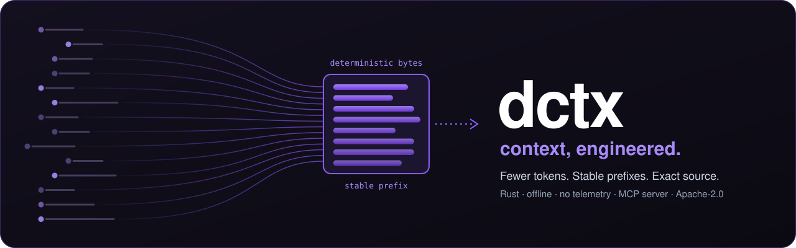

<!-- SPDX-License-Identifier: Apache-2.0 -->
<!-- SPDX-FileCopyrightText: 2026 Eris Margeta -->
<h1 align="center">dctx</h1>

<p align="center">
  
</p>

<p align="center">
  
  <a href="https://github.com/Eris-Margeta/dctx/actions/workflows/ci.yml?query=branch%3Amain">
    
  </a>
  <a href="https://github.com/Eris-Margeta/dctx/blob/main/LICENSE">
    
  </a>
  
  <a href="https://github.com/sponsors/Eris-Margeta">
    
  </a>
  <a href="https://www.dctx.internet.technology/maintenance/">
    
  </a>
  
</p>

<p align="center">
  <a href="#start-and-choose-your-path">Choose your path</a> •
  <a href="#which-mode">Which mode?</a> •
  <a href="#the-core-belief-prompt-processing-efficiency">Philosophy</a> •
  <a href="#installation">Installation</a> •
  <a href="#quick-start">Quick Start</a> •
  <a href="#what-the-output-looks-like">Output examples</a> •
  <a href="#use-as-a-library">Library</a> •
  <a href="#map-mode-context-for-agents">Map mode</a> •
  <a href="#security--privacy">Security & Privacy</a> •
  <a href="https://www.dctx.internet.technology/docs/spec/">Specification</a> •
  <a href="https://www.dctx.internet.technology/">Website</a>
</p>

<p>
  <strong>dctx turns any folder into the smallest correct context for a task, offline, with byte-stable output that prompt caches can reuse.</strong><br>
  dctx is an advanced tool with several ways to use it. Used well, it cuts the context an agent needs to a fraction. Used without a plan, it can add calls and tokens instead of removing them. If you are new, follow the safe path: one project, the system binary, the lean MCP profile. Measure before you change anything.
</p>

---

## Project status

**dctx is not yet stable and not enterprise-ready.** It has been in development since January 2026. Until version 2.0, expect breaking changes often. AI providers keep changing how they optimize context on their side; dctx adapts to those changes quickly, but not in real time. Stability is the goal of 2.0, and the project is working toward it: we see an ultimate solution to this problem, and we are denoising it.

dctx began as an internal tool that was never meant to be open-sourced, so parts of it are still messy. It was opened up because colleagues who rely on it needed it in the open, and development continues in public.

The founding promise is zero dependencies. Today dctx still has dependencies. The goal is to become the single best context management tool.

## Installation

**System binary — available now.** Download the archive for your OS and architecture
from [GitHub Releases](https://github.com/Eris-Margeta/dctx/releases/tag/v1.3.1),
compare its SHA-256 with the matching entry in `SHA256SUMS`, extract it, and put
`dctx` (`dctx.exe` on Windows) on `PATH`. Archives cover Linux x64/ARM64,
macOS x64/ARM64 and Windows x64. Releases after 1.2.0 also ship cosign signatures,
a CycloneDX SBOM, build provenance and offline bundles; see
[verification, provenance and offline installation](https://github.com/Eris-Margeta/dctx/blob/main/docs/VERIFYING.md).

```sh
dctx --version
```

**Node wrapper — available on npm.** Run `npm install dctx` to install the
[Node wrapper](https://github.com/Eris-Margeta/dctx/blob/main/packaging/npm/dctx/README.md) and its matching pinned
`@tejl/dctx-<platform>` native package, then `npx dctx --version` to check it.
The [Python](https://github.com/Eris-Margeta/dctx/blob/main/packages/python/README.md) and [Go](https://github.com/Eris-Margeta/dctx/blob/main/packages/go/README.md) wrappers
over `dctx rpc` are built and tested in CI; use their CI artifacts. The
[Rust facade](https://www.dctx.internet.technology/docs/modalities/#rust-library-embed-the-facade) is available from
tagged Git. Use the release archives for the CLI.

Follow [the safe path in ten minutes](https://www.dctx.internet.technology/docs/start/#safe-path-in-ten-minutes)
for one project, lean MCP setup and whole-session measurement.

<!-- output:begin -->
<!-- Generated by scripts/render_readme.py from tools/website/data/demo.json. -->

## What the output looks like

These are real runs on the tiny [kiosk sample](https://github.com/Eris-Margeta/dctx/tree/main/tools/website/sample), captured by [capture.py](https://github.com/Eris-Margeta/dctx/blob/main/tools/website/capture.py) from the release binary. Commands run inside a copy named `kiosk`. For source builds, the executable is `dctx-cli` (or define a `dctx` alias).

### Pack a project

The header explains the format, the tree assigns IDs, and file blocks carry paths and line counts. The first 40 output lines follow; only the tail is omitted. `.env` is listed without its contents.

```text
$ dctx pack .
[DCTX_LLM_CONTEXT_SNAPSHOT_V1]
[DIRECTORY:kiosk]
<INSTRUCTIONS>
1. Manifest: The <DIRECTORY_TREE> section lists all files.
   - Each entry: [TYPE] RELATIVE_PATH (ID:UNIQUE_ID)
   - TYPE is [D] for directory, [F] for file.
2. Content Access: To read a specific file:
   - Find its UNIQUE_ID from the directory tree.
   - Search for the marker: <FILE_CONTENT_START ID="UNIQUE_ID">
   - The content is between this marker and </FILE_CONTENT_END ID="UNIQUE_ID">
</INSTRUCTIONS>
<DIRECTORY_TREE>
[D]  (ID:ROOT)
  [F] .env (ID:F001)
  [F] .gitignore (ID:F002)
  [F] Cargo.toml (ID:F003)
  [F] README.md (ID:F004)
  [F] config.toml (ID:F005)
  [D] src (ID:D006)
    [F] src/main.rs (ID:F007)
    [F] src/store.rs (ID:F008)
    [F] src/util.rs (ID:F009)
  [D] tools (ID:D010)
    [F] tools/report.py (ID:F011)
  [D] web (ID:D012)
    [F] web/app.ts (ID:F013)
    [F] web/format.ts (ID:F014)
</DIRECTORY_TREE>
<FILE_CONTENT_START ID="F001" PATH=".env" LINES="0">
[Content omitted by pattern rules]
</FILE_CONTENT_END ID="F001">
<FILE_CONTENT_START ID="F002" PATH=".gitignore" LINES="2">
target/

</FILE_CONTENT_END ID="F002">
<FILE_CONTENT_START ID="F003" PATH="Cargo.toml" LINES="9">
[package]
name = "kiosk"
version = "0.1.0"
edition = "2021"
… (147 more lines)
```

### Find a symbol, then read it

Pass the exact ID from `find` to `read` to get its metadata and verified source bytes:

```text
$ dctx map find greet
# kiosk find
s:src/util.rs#greet	fn	L2-4
s:web/app.ts#renderGreeting	fn	L10-12
```

```text
$ dctx map read 's:src/util.rs#greet'
# kiosk read
s:src/util.rs#greet	fn	src/util.rs
pub fn greet(name: &str) -> String {
    format!("Hello, {}!", title_case(name))
}
```

For structured consumption, `--json` puts the same source bytes in `source_utf8` (one JSON line, shown verbatim):

```text
$ dctx map read 's:src/util.rs#greet' --json
{"v":2,"place":"kiosk","verb":"read","freshness":{"mode":"strict","state":"verified"},"precision":{"coverage":"syntax","completion":"complete","parser":"dctx-lex-rust/syn-3.0.9"},"records":[{"id":"s:src/util.rs#greet","kind":"fn","path":"src/util.rs","lines":[2,4],"summary":"The greeting shown on the kiosk screen.","summary_source":"doc","signature":null,"span":[44,126],"source_utf8":"pub fn greet(name: &str) -> String {\n    format!(\"Hello, {}!\", title_case(name))\n}","edge":null,"direction":null,"target":null,"confidence":null}],"more":0,"next":null}
```

### Pack for a task

`--for` uses the task terms to select find results, neighbors and source reads. `--budget 800` bounds estimated output tokens, not scan size; the footer reports usage and dropped records.

```text
$ dctx pack . --for 'greet store' --budget 800
# dctx pack --for budget=800 terms=2
## find greet
s:src/util.rs#greet	fn	L2-4
s:web/app.ts#renderGreeting	fn	L10-12
## find store
s:src/store.rs#Order	struct	L4-8
s:src/store.rs#checksum	fn	L22-24
s:src/store.rs#encode	fn	L17-19
## neighbors s:src/util.rs#greet
calls:in:s:src/main.rs#main	fn	src/main.rs	L7
calls:out:s:src/util.rs#title_case	fn	src/util.rs
contains:in:m:src/util.rs	module	src/util.rs
## neighbors s:src/store.rs#Order
contains:in:m:src/store.rs	module	src/store.rs
## read s:src/util.rs#greet
s:src/util.rs#greet	fn	src/util.rs
pub fn greet(name: &str) -> String {
    format!("Hello, {}!", title_case(name))
}
## read s:src/store.rs#Order
s:src/store.rs#Order	struct	src/store.rs
pub struct Order {
    pub id: u32,
    pub item: String,
    pub qty: u32,
}
# end body_tokens=223 budget=800 dropped=0
```
<!-- output:end -->

## Which mode?

- [CLI and one-off chat](https://www.dctx.internet.technology/docs/modalities/#human-one-off-pack-to-clipboard): pack selected source for a prompt or use the interactive terminal.
- [Agents, short tasks](https://www.dctx.internet.technology/docs/modalities/#short-agent-task-grep-can-be-enough): compare with grep plus narrow file reads first.
- [Agents, long sessions and huge trees](https://www.dctx.internet.technology/docs/modalities/#huge-trees-scope-before-indexing): scope the root, find symbols and read exact source.
- [MCP](https://github.com/Eris-Margeta/dctx/blob/main/docs/guides/MCP.md): use the lean profile to start; ACP is planned.
- [Libraries](https://www.dctx.internet.technology/docs/modalities/#rust-library-embed-the-facade): embed the Rust facade today; install the [Node wrapper](https://github.com/Eris-Margeta/dctx/blob/main/packaging/npm/dctx/README.md) with `npm install dctx`, or use CI artifacts for the Python and Go wrappers.
- [CI and prompt caching](https://www.dctx.internet.technology/docs/modalities/#ci--prompt-cache-prefix-stability): pin inputs and measure byte stability and provider cache behavior.
- [Desktop](https://www.dctx.internet.technology/docs/modalities/#desktop-app-tauri-preview-today): build the Tauri 0.11 preview; the GPUI rebuild is planned.

## Measured, in the open

<!-- bench:begin -->
<!-- Generated by scripts/render_readme.py. Baseline observations: docs/BENCHMARK-20261030.md; historical timing: docs/research/bench-3way-20261030/results/run7-53f8b6b/aggregate.json. -->

The baseline is **grep plus reading files**.

A controlled grep-plus-read benchmark that counts whole agent sessions (start-up context, every call, provider cache hits and accuracy) is being prepared; until it is published, dctx makes no whole-session savings claim.

Historical cold indexing of six benchmark corpora took dctx 0.13–1.20 s on one Linux x86_64 runner. This measures CLI wall time, not agent completion time or session cost.

[Choosing how to use dctx](https://www.dctx.internet.technology/docs/modalities/) covers scoping and MCP startup overhead. [Measurement evidence](https://www.dctx.internet.technology/docs/benchmark/) describes what was measured (tool-output bytes and estimated tokens); other-tool protocols are retained only as secondary historical notes.
<!-- bench:end -->

## Start and choose your path

[What dctx is](https://www.dctx.internet.technology/docs/start/), [four user paths](https://www.dctx.internet.technology/docs/start/#choose-your-path),
[responsibilities](https://www.dctx.internet.technology/docs/start/#responsibilities), and
[two scopes, one binary](https://www.dctx.internet.technology/docs/start/#two-scopes-one-binary) explain setup and
ownership. The [documentation index](https://github.com/Eris-Margeta/dctx/blob/main/docs/README.md) groups modalities, scopes,
engine behavior, reference material, trust and evaluator evidence.

“Smallest correct context” is the goal: selection is lexical and bounded, not a
proof of task completeness or a mathematical minimum. Large folders need scoped
roots; budgets bound answers, not scans. Provider cache hits and whole-session
savings must be measured. See [current limits](https://www.dctx.internet.technology/docs/modalities/) and the
[specification and roadmap](https://www.dctx.internet.technology/docs/spec/).

## The core belief: prompt-processing efficiency

Send fewer relevant bytes, keep their order stable, and verify exact source.
dctx does not use embeddings; it selects lexical symbols and document sections.

- **Bounded**: map answers use estimated token budgets and whole records.
- **Deterministic**: identical source snapshots and requests give identical bytes.

Read the [philosophy](https://www.dctx.internet.technology/why/) and its
[testable constraints](https://www.dctx.internet.technology/docs/spec/#2-the-core-belief-prompt-processing-efficiency).

## Quick Start

Try a tiny project (POSIX shell; on Windows use Git Bash):

```sh
mkdir dctx-demo
cd dctx-demo
printf 'def hello(name):\n    return f"Hello, {name}!"\n' > hello.py
dctx map skeleton hello.py
```

Use the [safe path](https://www.dctx.internet.technology/docs/start/#safe-path-in-ten-minutes) or the
[runnable pack and map example](https://github.com/Eris-Margeta/dctx/blob/main/examples/README.md). For repeated agent work,
see [Map mode: context for agents](https://www.dctx.internet.technology/docs/map-mode/) and the
[MCP client guide](https://github.com/Eris-Margeta/dctx/blob/main/docs/guides/MCP.md).

## Map mode: context for agents

From this repository's root:

```zsh
dctx map find "Session"
```

Read exact IDs from the result with `dctx map read 'ID' --json`.
See the [map guide](https://www.dctx.internet.technology/docs/map-mode/) for commands, budgets and limits.

## From source

Requires Rust 1.91 or newer.

```sh
git clone https://github.com/Eris-Margeta/dctx
cd dctx
cargo build --locked --release -p dctx-cli
./target/release/dctx-cli --version
alias dctx="$PWD/target/release/dctx-cli"
```

Cargo builds `dctx-cli` (`dctx-cli.exe` on Windows); release archives supply
`dctx`. For a local source installation, use
`cargo install --locked --path crates/dctx-cli` and `alias dctx=dctx-cli`.
On Windows, invoke the executable directly or create a PowerShell alias.
See [CI coverage and desktop exclusions](https://github.com/Eris-Margeta/dctx/blob/main/docs/TESTING.md).

## Use as a library

The public Rust entry point is the [`dctx` facade](https://github.com/Eris-Margeta/dctx/tree/main/crates/dctx), available from
Git now; **crates.io publication is pending**.

```toml
[dependencies]
dctx = { git = "https://github.com/Eris-Margeta/dctx", tag = "v1.3.1" }
```

This example is generated from the [workspace doctest](https://github.com/Eris-Margeta/dctx/blob/main/examples/library/README.md):

<!-- library:begin -->
```rust
use dctx::{memory::{CancelFlag, FixedClock, MemorySource}, *};
let mut source = MemorySource::new();
source.insert_file("hello.rs", b"pub fn hello() {}\n", 0)?;
let mut session = Session::builder(source).clock(FixedClock(Timestamp(0)))
    .cancellation(std::sync::Arc::new(CancelFlag::new())).ceiling(HostCeiling::base())
    .selection(SelectionPolicy::from_texts(&RuleTexts::default())).grants(HostGrants::PermitAll)
    .storage(StoragePolicy::Ephemeral { max_bytes: 8 * 1024 * 1024 }).place("demo").view("pack").build()?;
let mut output = VecSink::new();
session.pack(&PackRequest::new(), &mut output)?;
println!("{}", std::str::from_utf8(output.as_bytes())?);
```
<!-- library:end -->

The host supplies selection rules and storage policy; `FsSource` does not
load `.gitignore` automatically. Read the
[library integration boundary](https://www.dctx.internet.technology/docs/modalities/#rust-library-embed-the-facade)
before embedding it. Python, Node and Go wrappers over `dctx rpc` live in
[packages/python](https://github.com/Eris-Margeta/dctx/blob/main/packages/python/README.md), [packaging/npm](https://github.com/Eris-Margeta/dctx/blob/main/packaging/npm/dctx/README.md)
and [packages/go](https://github.com/Eris-Margeta/dctx/blob/main/packages/go/README.md); they are built and tested in CI.
Install the Node wrapper with `npm install dctx`; use CI artifacts for Python and Go.

## CLI Reference

```
Usage: dctx <COMMAND> [OPTIONS]
       dctx pack [PATH] [--output PATH] [--clipboard] [--json]
       dctx pack [PATH] --for <TEXT> [--budget TOKENS]
       dctx map <map|find|neighbors|explain|read|skeleton|grep|hubs|path> [--json]
       dctx context TARGET [--place PATH] [--budget N] [--json] [--session ID --dedupe]
       dctx rpc
       dctx mcp [PATH]
       dctx serve [--mcp] [PATH]
       dctx read <TARGET> [OPTIONS]
       dctx languages [--json|--markdown]
       dctx doctor [--json]
       dctx cache status [--json] [--root PATH]
       dctx cache gc [--dry-run] [--root PATH] [--max-bytes N]
       dctx cache purge --root PATH [--dry-run] [--yes]
       dctx cache purge --all [--dry-run] [--yes]
       dctx cache config [auto on|off] [--max-bytes N] [--ttl-days N]
       dctx cache auto [--json]
       dctx template build <PATH> [--output PATH]
       dctx template list [--dir PATH]
       dctx plugin search|install|list|info|enable|disable|remove|update|verify
       dctx git <status|protect>

Pack filters:
  --ext <extensions>    Only files with these extensions (comma-separated)
  --binary              Include binary files (omitted by default)
  --empty               Only 0-byte files
  --non-empty           Only files with content
  --large <MB>          Only files larger than this many megabytes
  --small <MB>          Only files smaller than this many megabytes
  --hidden              Only hidden files and directories
  --debug-ignored       List ignored directories without reading them
  --include <pattern>   Only files matching this ignore-rule glob (repeatable)
  --exclude <pattern>   Drop files matching this ignore-rule glob (repeatable)
  --output, -o <path>   Write the page to one file
  --clipboard, -c       Copy the page to the clipboard
  --json                Summary report; with --for, the facade JSON context page
  --tree-stamps=on|off  MOD: timestamp on tree lines (default off; on = the 1.0.0 text)
Task context (agent cards):
  --for <text>          Map find on the names in <text>, then neighbors and read of the best hits
  --budget <tokens>     With --for: estimated-token cap, 100..100000 (default 3000)
```

- `dctx context` returns ranked context for a file, symbol name or stable node id;
  repeated targets in one call share a delivery session.
- `dctx rpc` serves the versioned engine protocol used by the language wrappers
  ([protocol](https://github.com/Eris-Margeta/dctx/blob/main/docs/protocol/README.md)); send `hello` first.
- `dctx mcp` and `dctx serve [--mcp]` serve the map verbs as MCP tools over stdio;
  `dctx read` is `dctx map read`. `dctx map export` writes the whole graph as JSON or Mermaid.
- `dctx languages` lists every supported language and its tier.
- `dctx doctor` lists visible dctx binaries, their scopes, SHA-256 checksums and
  cache sizes, without network access or cache changes.

Run `dctx --help`, `dctx pack --help` and `dctx map --help` for the complete
reference and `dctx --version --verbose` for feature and precision limits.


See [map commands and limits](https://www.dctx.internet.technology/docs/map-mode/),
[MCP profiles](https://github.com/Eris-Margeta/dctx/blob/main/docs/guides/MCP.md), [exit codes](https://www.dctx.internet.technology/docs/exit-codes/),
[templates](https://www.dctx.internet.technology/docs/templates-contract/), and [plugins](https://www.dctx.internet.technology/docs/plugins/).
Native plugin launch is currently refused by the product host; consent alone
does not enable it. Organization policy and `dctx policy explain` are planned.

### Language tiers


`dctx languages` prints this table (`--json` for tools, `--markdown` for this block) from the one registry that also drives `dctx --version --verbose`; a test fails when the block below differs from it.

- **full**: symbols and call edges. Call edges are lexical, not type-resolved: they come from names, scopes and imports, never from a type checker, and ambiguous references are dropped.
- **outline**: symbols only; no call edges are promised. Shell function bodies can yield same-file call guesses, but v1 does not promise shell call edges.
- **docs**: headed sections.
- **Confidence**: `guess` marks the heuristic outline families, and every record from those files carries confidence `guess`; `structural` means a dedicated lexer or deterministic document rules.

<details><summary>Full language table</summary>

<!-- languages:begin -->
| Language | Tag | Files | Tier | Confidence |
|---|---|---|---|---|
| Rust | `rust` | `.rs` | full | structural |
| JavaScript | `javascript` | `.js`, `.mjs`, `.cjs`, `.jsx` | full | structural |
| TypeScript/TSX | `typescript` | `.ts`, `.mts`, `.cts`, `.tsx` | full | structural |
| Python | `python` | `.py`, `.pyi` | full | structural |
| Go | `go` | `.go` | full | structural |
| Java | `java` | `.java` | full | structural |
| C/C++ | `c` | `.c`, `.h`, `.cc`, `.cpp`, `.cxx`, `.hpp`, `.hh` | full | structural |
| C# | `csharp` | `.cs` | full | structural |
| Kotlin | `kotlin` | `.kt`, `.kts` | full | structural |
| Ruby | `ruby` | `.rb`, `.rake`, `.gemspec`, `Rakefile`, `Gemfile` | full | structural |
| PHP | `php` | `.php`, `.phtml`, `.inc` | full | structural |
| Swift | `swift` | `.swift` | full | structural |
| Vue/Svelte/Astro/HTML script blocks | `web` | `.vue`, `.svelte`, `.astro`, `.html`, `.htm` | full | structural |
| Scala | `scala` | `.scala`, `.sc` | full | guess |
| Dart | `dart` | `.dart` | full | guess |
| Zig | `zig` | `.zig` | full | guess |
| Solidity | `solidity` | `.sol` | full | guess |
| Gleam | `gleam` | `.gleam` | full | guess |
| Fortran | `fortran` | `.f90`, `.f95`, `.f03`, `.f08`, `.f`, `.for` | full | guess |
| Perl | `perl` | `.pl`, `.pm`, `.t`, `.psgi` | full | guess |
| Groovy | `groovy` | `.groovy`, `.gradle` | full | guess |
| PowerShell | `powershell` | `.ps1`, `.psm1`, `.psd1` | full | guess |
| Elixir | `elixir` | `.ex`, `.exs` | full | guess |
| Lua | `lua` | `.lua` | full | guess |
| OCaml | `ocaml` | `.ml`, `.mli` | full | guess |
| R | `r` | `.r` | full | guess |
| Julia | `julia` | `.jl` | full | guess |
| Haskell | `haskell` | `.hs` | full | guess |
| Erlang | `erlang` | `.erl`, `.hrl` | full | guess |
| Verilog/SystemVerilog | `verilog` | `.v`, `.vh`, `.sv`, `.svh` | full | guess |
| Terraform/HCL | `hcl` | `.tf`, `.tfvars`, `.hcl` | full | guess |
| SQL | `sql` | `.sql`, `*.sql.in` | full | guess |
| Clojure | `clojure` | `.clj`, `.cljs`, `.cljc`, `.edn` | full | guess |
| Common Lisp | `lisp` | `.lisp`, `.lsp`, `.cl` | full | guess |
| Scheme | `scheme` | `.scm`, `.ss` | full | guess |
| Emacs Lisp | `elisp` | `.el` | full | guess |
| JSON/JSONC/TOML/YAML | `config` | `.json`, `.jsonc`, `.toml`, `.yaml`, `.yml` | outline | structural |
| Shell | `shell` | `.sh`, `.bash`, `.zsh`, `.bats` | outline | guess |
| Makefile | `make` | `.mk`, `Makefile`, `GNUmakefile` | outline | guess |
| Dockerfile | `docker` | `Dockerfile`, `Containerfile` | outline | guess |
| Protobuf | `proto` | `.proto` | outline | guess |
| Pascal | `pascal` | `.pas`, `.pp`, `.dpr` | outline | guess |
| GraphQL | `graphql` | `.graphql`, `.gql` | outline | guess |
| Nix | `nix` | `.nix` | outline | guess |
| Markdown | `markdown` | `.md`, `.markdown` | docs | structural |
| Plain text | `text` | `.txt` | docs | structural |
| reStructuredText | `rst` | `.rst` | docs | structural |
| AsciiDoc | `asciidoc` | `.adoc`, `.asciidoc` | docs | structural |
| Org | `org` | `.org` | docs | structural |
| LaTeX | `tex` | `.tex` | docs | structural |
<!-- languages:end -->

</details>


## Security & Privacy

Pack, map and MCP run locally and have **no telemetry**, **call no model** and
**make no network calls**. Selection happens before any byte is read, hashed,
parsed or cached, and is checked again before output leaves the engine.

| Rule file | Behaviour |
|---|---|
| `.gitignore`, `.dctxignore`, global ignore file | Excluded from normal selection; `--debug-ignored` shows ignored path metadata without reading content |

The global ignore file is `<config dir>/dctx/ignore`: `$XDG_CONFIG_HOME/dctx/ignore`
or `~/.config/dctx/ignore` on Linux and macOS, `%APPDATA%\dctx\ignore` on Windows.
dctx does not read Git metadata, so `.git/info/exclude` and Git's
`core.excludesFile` are **not** applied: copy those patterns into `.dctxignore` or
the global ignore file when they must keep files out of a pack.

`DCTX_INDEX_IGNORED=1` skips those ignore texts, so leave it unset when relying
on them. Built-in sensitive-file and `.git` exclusions still apply.

Sensitive files such as `.env`, private keys and credentials are omitted from
content reads even with ignore negations; pack may list their names.
`.git` at any depth is never listed or read by map, and is never read by pack.
Symlinks are never followed; final-component file opens use `O_NOFOLLOW`.
dctx decides by file name only: a secret pasted into an ordinary source file
is not detected. Inspect context before sharing it.
The [privacy contract and deny list](https://www.dctx.internet.technology/docs/privacy/)
and [map privacy guide](https://www.dctx.internet.technology/docs/map-mode/#index-cache-and-privacy) explain
the boundary. Report vulnerabilities privately through [SECURITY.md](https://www.dctx.internet.technology/security/).

The [release check](https://github.com/Eris-Margeta/dctx/blob/main/scripts/release-check.sh) tests socket activity under
`strace -f` and reports SKIP where tracing cannot run. Plugin network and
organization policy designs in the spec include planned features;
see [current plugin limits](https://www.dctx.internet.technology/docs/plugins/#what-is-not-yet-available).

## Open source and maintenance

dctx and its desktop app are [Apache-2.0](https://github.com/Eris-Margeta/dctx/blob/main/LICENSE), copyright Eris Margeta.
Every modality stays open. [GitHub Sponsors](https://github.com/sponsors/Eris-Margeta)
and [maintenance agreements](https://www.dctx.internet.technology/maintenance/) fund upkeep without changing the
license. See [trademark policy](https://www.dctx.internet.technology/trademark/), [NOTICE](https://github.com/Eris-Margeta/dctx/blob/main/NOTICE),
[Rust dependencies](https://github.com/Eris-Margeta/dctx/blob/main/THIRD_PARTY.md) and [npm dependencies](https://github.com/Eris-Margeta/dctx/blob/main/THIRD_PARTY_NPM.md).

## Where it comes from

dctx started in 2025 as `dircontxt` in C and was rewritten in Rust in 2026.
The [changelog](https://www.dctx.internet.technology/changelog/) and [`legacy-c/`](https://github.com/Eris-Margeta/dctx/tree/main/legacy-c) preserve that history.

## Contributing

Read [CONTRIBUTING.md](https://www.dctx.internet.technology/docs/contributing/), the [specification](https://www.dctx.internet.technology/docs/spec/) and
[crate map](https://www.dctx.internet.technology/docs/crate-map/).

[Website](https://www.dctx.internet.technology/) ·
[Documentation](https://github.com/Eris-Margeta/dctx/blob/main/docs/README.md) ·
[For AI evaluators](https://github.com/Eris-Margeta/dctx/blob/main/docs/README.md#for-ai-evaluators) ·
[llms-small.txt](https://www.dctx.internet.technology/llms-small.txt) ·
[llms.txt](https://www.dctx.internet.technology/llms.txt) ·
[llms-full.txt](https://www.dctx.internet.technology/llms-full.txt)
